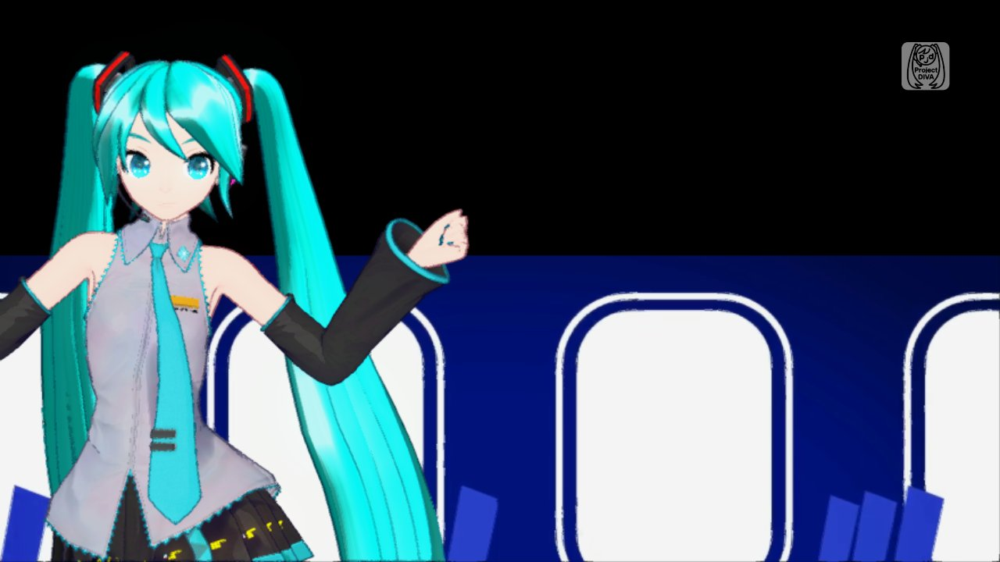
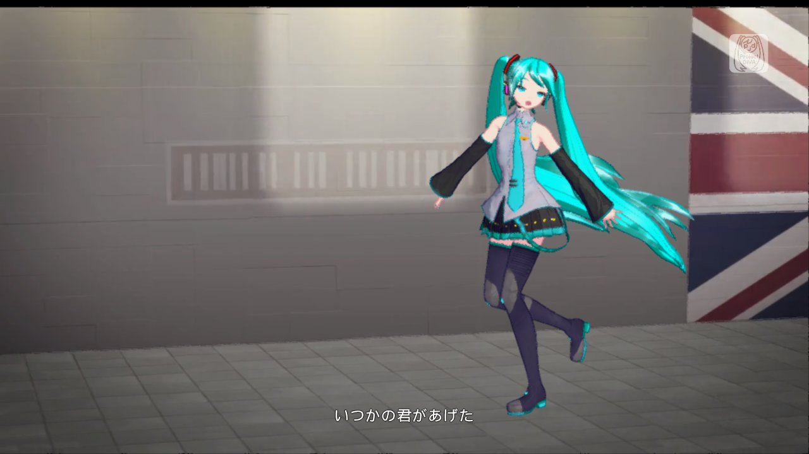
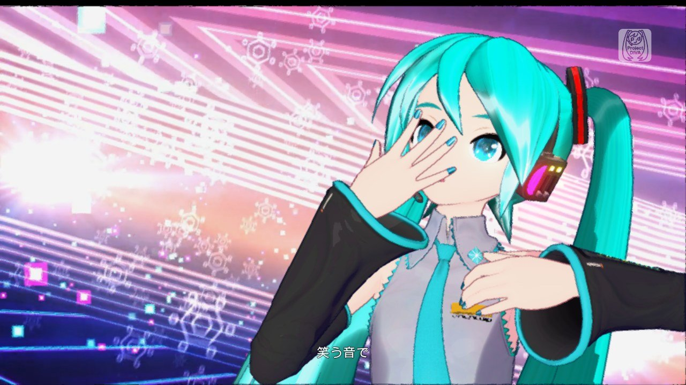
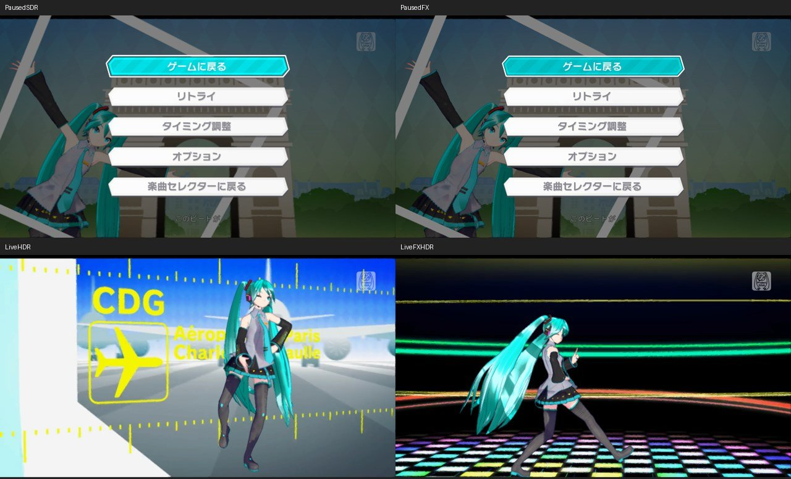

# Catch the Wave 视频背景黑块 / Video background origin

2026-11-01 · **本报告验证使用本地源码候选（设备版本号19）；相同修正纳入 build20 精简预览。测量范围不变，不代表新版全部功能的整体验收。**

## 结论与范围

在 iPhone Air 上复现了 build19 的大片黑色背景；1080p、HDR 关闭、原版资源、原版 Miku 服装，无模型／歌曲 MOD。切换普通放大后仍在，不能归因于 MetalFX 本身。用户也报告 M5 模拟器出现同样情况。

已修改两端共用的 NVN→Metal 视频背景路径。真机候选的街景、天空、车厢及彩色线条背景恢复；一次含暂停／画质切换的 PV 播放及一次 1080p MetalFX／SDR 重试均到达原生结束菜单，随后正常返回选曲。**这是 PV 与显示链验证，不是真人打歌、所有歌曲、所有服装或稳定帧率验收；本轮未重新部署模拟器。**

## 定位证据

同帧抓取包含解码后的 Y／UV 纹理、背景目标、后期场景及最终 drawable。解码纹理完整，黑块最早出现在背景绘制后的目标中，早于超分和 HDR。

捕获帧 F6021 的背景绘制使用 VS `36f85460a1ac1b59`／FS `39edbcb0e6bbc351`，目标为 1280×720。游戏该曲的有效内部尺寸是 880×495：视频矩形占 `(0,225)–(880,720)`，后续合成读取上方的 `(0,0)–(880,495)`，形成大块空白。顶点、64 字节投影矩阵和纹理均有同帧证据；这不是从黑色外观推测缺失文件。

修正只匹配该视频顶点接口，同时转换矩形 Y 与解码纹理 V，保留图像方向，让有效区域与当前后期链的左上角约定一致。全屏视频的结果保持不变。不修改原始资源、全局相机、灯光、材质或任意精灵。通过 attribute 2／varying location 1 识别坐标，避免依赖翻译器临时变量名；未知接口保留原着色器并记录原因。`PJDV_MOVIE_ORIGIN=0` 仅供开发侧启动时 A/B。

ReDIVA 的 [TaskMovie::disp](https://github.com/korenkonder/ReDIVA/blob/master/src/ReDIVA/task_movie.cpp) 和 [背景精灵合成](https://github.com/korenkonder/ReDIVA/blob/master/src/CRE/render_manager.cpp) 用于理解视频矩形／背景目标，**实际 Switch 修正以本地捕获数据为依据**。

## 检查结果

环境：iPhone Air / iOS 27.2；JP v1.0.9 资源；原生 60 FPS 设置，输出 1920×1080；原版阴影，未启用 RT 或插帧。

| 检查 | 结果与限制 |
| --- | --- |
| 普通 1080p、SDR | 捕获源画面与最终输出，大片背景空白消失 |
| MetalFX 1080p、SDR | 暂停同镜头对照及再次播放抽样正常；捕获实际 Spatial 输出 |
| 普通 1080p、HDR | 连续播放捕获，日志确认 `matchedScene=1`，高光映射实际工作 |
| MetalFX 1080p、HDR | 连续播放捕获，`matchedScene=1`；实际 Spatial／HDR／drawable 均保存 |
| 浮点输出 | 本次 HDR 捕获中的 RGB 无 NaN／Inf；不等于所有画面 HDR 质量验收 |
| 片头／菜单 | 候选可显示 SEGA 片头、主菜单与选曲菜单；全屏视频方向正确 |
| 原生 GPU 合成测试 | 非对称合成图案、三种有效尺寸、全屏图像保持、接口隔离、重复应用、A/B 关闭通过；实际游戏缓存接口可编译 |
| 抓帧检查 | 各阶段身份、RGBA16F、行对齐、关闭状态无读回、旧模式兼容、容量限制和缓冲生命周期通过 |

SDR 对照在同一暂停镜头进行；HDR 暂停时缺少本帧 3D 数据，会回落 SDR，因此 HDR 两组改为连续播放抽样，**不是同一时间点的逐像素四组 A/B**。HDR 预览图会裁至 SDR 范围，不能展示屏幕真实高光亮度。详细格式／尺寸／有限值统计见 [stage-validation.json](images/catch-wave-20261101/stage-validation.json)。

诊断只在显式开发启动参数下生效：`PJDV_CAPTURE_ENABLE=1` 与 `PJDV_PRESENT_CAPTURE=1`，一次请求最多一个正在写盘的 present 抓取，组合读回预算 96 MiB。普通启动保持 framebuffer-only，不做逐帧读回。完整私有抓帧不公开；图中只有游戏画面，未含设备标识、路径、密钥、资源档案或存档。

**本次未测功耗／持续帧时间，也未验证新 MOD 安装、存档迁移、SPiCa、Calc 或 New Classics。** 下一发布仍需要原生导入＋组合＋正常存档的真机闭环与其他歌曲回归。

## English

**These tests used a local source candidate (device bundle version19). The same correction ships in the build20 lightweight preview. The validation scope below does not qualify every build20 feature.**

The large black background reproduced on an iPhone Air at 1080p with HDR off, original resources and an original Miku module, without song/model MODs. It persisted with ordinary scaling. The user also reported it in the M5 Simulator.

Same-frame Y/UV textures were complete. The first bad result was the movie-background render target, before postprocessing, Spatial or HDR. Capture F6021 used movie VS `36f85460a1ac1b59` and FS `39edbcb0e6bbc351`. Inside a 1280×720 backing texture, the 880×495 movie rectangle occupied `(0,225)–(880,720)`, while later composition sampled the top-left `(0,0)–(880,495)` region. Captured vertices, the projection matrix and input textures support this diagnosis.

The shared NVN→Metal fix converts the authenticated movie rectangle and decoder UV together. It preserves full-surface video orientation and aligns reduced-resolution backgrounds with the translated postprocess chain. It does not edit video assets, cameras, lighting, materials or arbitrary sprites. Coordinates are identified by attribute 2 / varying location 1 rather than generated variable names. Unknown interfaces retain the original shader; `PJDV_MOVIE_ORIGIN=0` is a developer-only startup bypass. The linked ReDIVA code helped explain the rendering structure; actual Switch captures determine the correction.

On the iPhone candidate, street, sky, train and colored-line backgrounds displayed again. A PV run including pauses/output switches and a 1080p Spatial/SDR retry both reached their native end menus, followed by a normal return to song selection. SDR ordinary scaling and Spatial were compared on a paused shot. HDR and Spatial+HDR were sampled during live playback, with `matchedScene=1` confirming real scene mapping. Their captured floating-point RGB values were finite. These HDR samples are **different time points, not a pixel-identical four-way A/B**. The previews above clip EDR to SDR and cannot represent physical HDR brightness.

Actual-GPU synthetic checks cover asymmetric movie pixels, three active sizes, unchanged full-frame video, interface isolation, idempotence and bypass; the actual generated game shader also compiles. Stage-readback checks cover identity, half-float format, padded rows, disabled behavior, legacy compatibility, budget rejection and resource lifetime. Explicit diagnostic capture is bounded and off during normal startup; private raw captures are not published.

This validates the sampled PV/display path on iPhone Air / iOS 27.2 with native60 selected, 1080p output and original shadows. **It does not establish manual rhythm gameplay, all songs/modules, sustained performance, HDR quality across all scenes or Simulator deployment.** No original XCI/resources or saves were replaced. Native MOD import/composition/save acceptance, migrations and the separate SPiCa/Calc/New Classics work remain pending before the next release.
