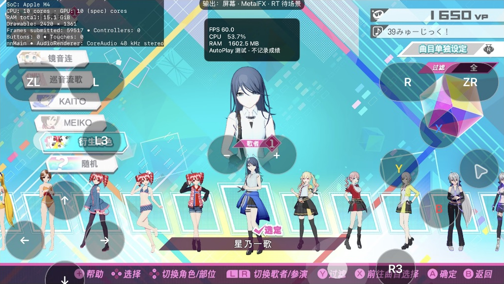
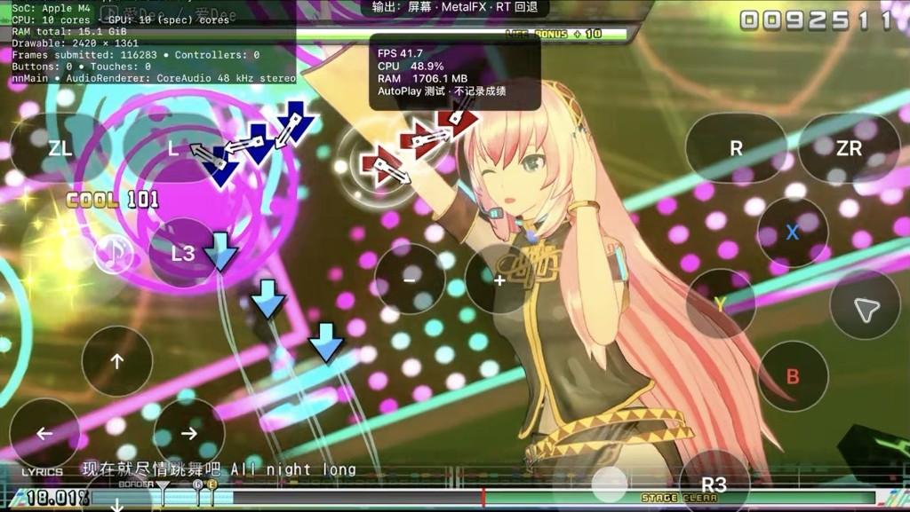
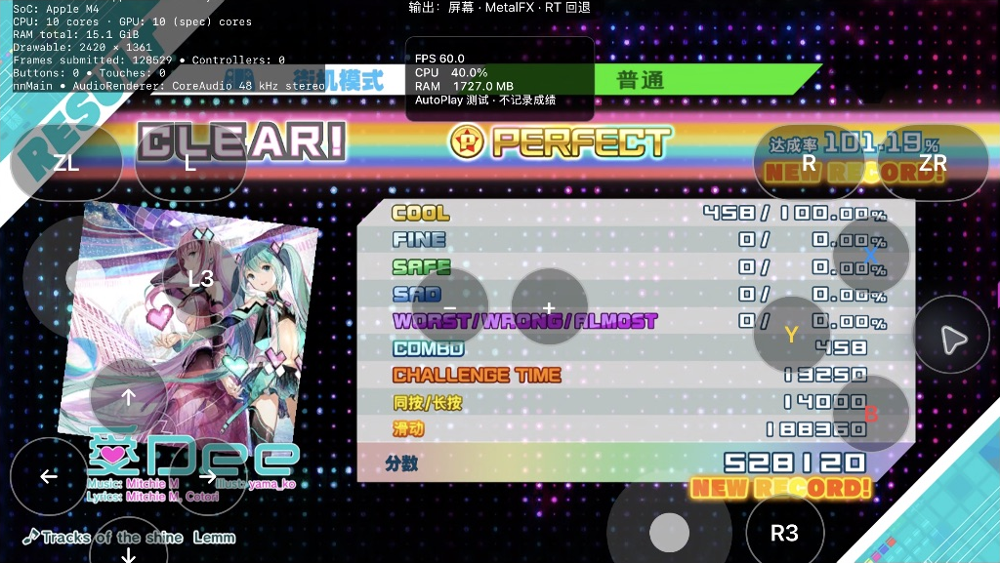

# X Song + LeoNeed 组合验证 / Combined MOD trial

2026-10-29，M4 iPad Pro 11 英寸，现有本地测试 App。用户已允许同时启用多个包；本轮使用预先合并的组合条目，**尚未实现任意多选组合的通用管理界面**。

## 组合方法

- 两个包：X Song Pack、LeoNeed Module Pack。原 PC MOD、原游戏资源和单包转换结果均保留不变。
- 三方合并原始数据库及两份包的增量；将模型的 16 个对象、59 个纹理重新分配到 X Song 使用范围之后，并同步对象材质中的纹理引用。
- 合并 8 组模型精灵与歌曲图片索引，覆盖实际读取的语言及 DLC18 数据库路径，保留修正后的星乃一歌名称和模型预览。
- 合并补丁为 49 文件、30,656,164 字节；组合含 4 层、993 个载荷文件。
- iPad 的文件传输服务不支持硬链接，因此其余 944 文件以 1 MiB 缓冲复制，共 2,949,249,016 字节；传输前后完成 SHA-256 校验。不能把这次复制称为去重。
- 使用组合独立存档目录，AutoPlay 使用临时存档；菜单阶段已核对两份原版正式存档 SHA-256 不变。

## 观察与边界

- 组合条目可进入标题、主菜单、选曲及角色自定义。
- 星乃一歌名称、底部模型预览及更换后的实际模型可见。
- X Song 的《愛Dee／爱Dee》NORMAL 可选，封面与歌曲 Logo 可见，实际谱面与歌词显示，整曲完成：**458 COOL、458 连击、101.19%、528120 分**。这是 AutoPlay 的实验结果，不是正式成绩；结果界面的 NEW RECORD 仅发生在临时测试存档中。
- 整曲结束后再次核对两份原版正式存档 SHA-256，均未改变。日志确认游戏写入的是 `GuestTemp/AutoPlay` 临时目录。
- 当前“屏幕尺寸＋MetalFX”输出的运行抓帧显示约 42 FPS，不能认定稳定 60 FPS；组合加载正确与性能达标应分别验收。此歌曲包含预录视频，所选 Ichika 不会替换视频内人物；实际模型验证来自自定义界面。
- 这一首样本不能代表其他歌曲或任意包组合兼容。游戏画面中的瞬时 FPS 不能代表整曲稳定帧率。
- New Classics 没有参与本轮运行；其谱面与判定机制尚未接入，不能以这次普通曲包运行证明 New Classics 已可用。

## English

This trial combines X Song Pack and LeoNeed Module Pack in a single prepared recipe on the M4 iPad. It does not add an arbitrary multi-selection manager. Base resources, source PC MODs and single-pack conversions remain unchanged.

The composition remaps 16 model objects and 59 textures after the song pack's ID range, updates material references, and merges 8 model sprite sets with the song artwork databases, including language and DLC18 paths. It contains 4 layers and 993 payload files. The merge patch has 49 files (30,656,164 bytes). Device hardlinks were unsupported: the other 944 files (2,949,249,016 bytes) were copied with a 1 MiB buffer and verified with SHA-256.

Menus, Ichika's name, portrait and equipped model work in this combination. Ai Dee NORMAL, its cover, logo and lyrics work. The full song completed with **458 COOL, 458 combo, 101.19%, 528120 points** in disposable AutoPlay testing. The result screen's NEW RECORD applies only to that temporary save. Both normal save hashes were checked again after completion and remained unchanged; logs show writes under GuestTemp/AutoPlay.

Gameplay captures showed approximately 42 FPS with screen-sized MetalFX output: this is a loading/gameplay compatibility pass, not a stable-60-FPS performance pass. Ai Dee includes prerecorded video, so the selected Ichika does not replace performers in that video; model validation comes from customization. New Classics is not active, and this does not establish its gameplay or arbitrary MOD compatibility.

## 实机截图 / Device evidence

