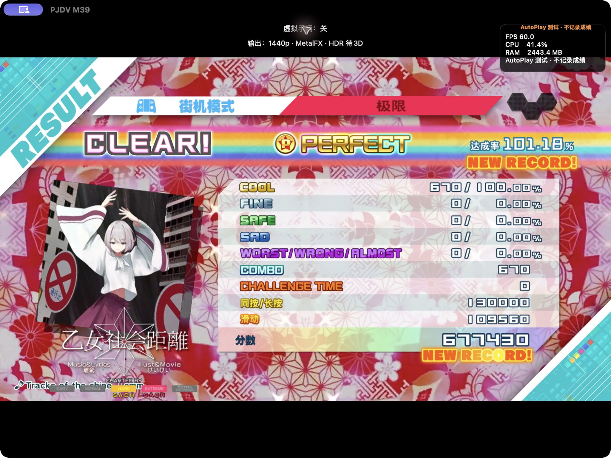
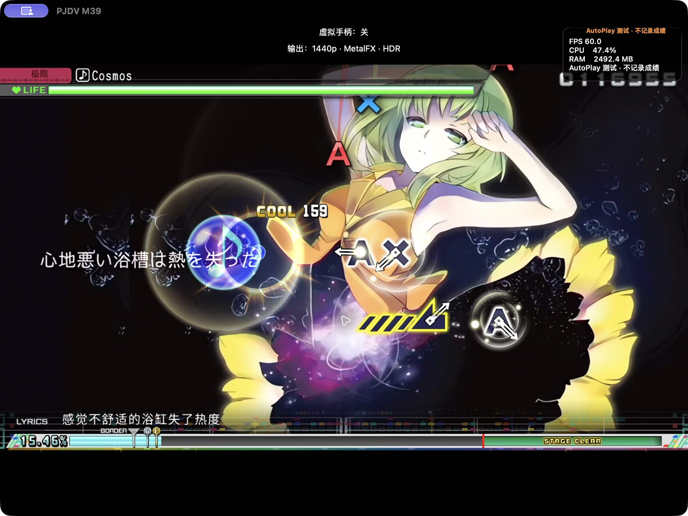
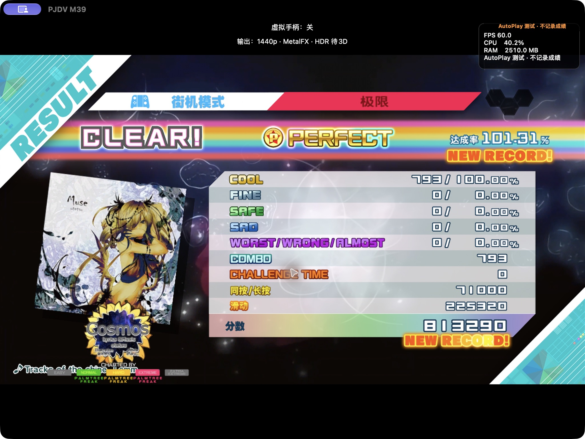
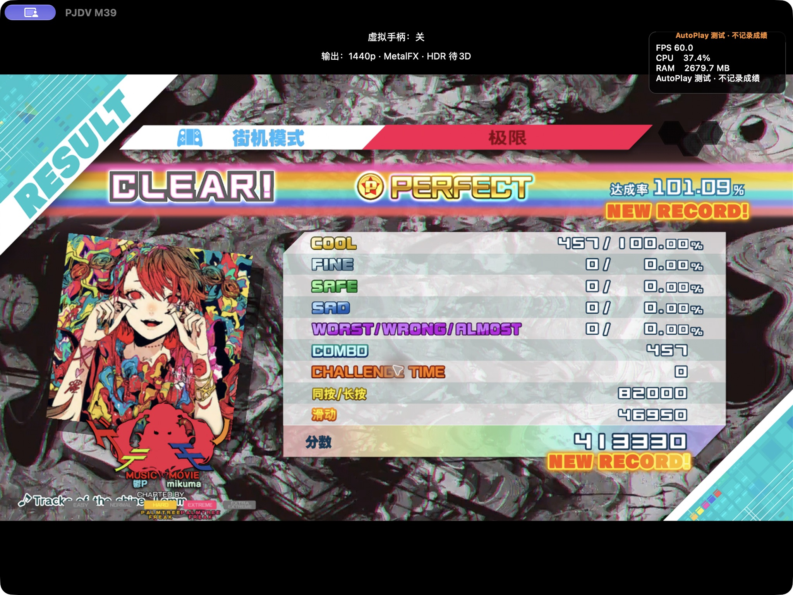
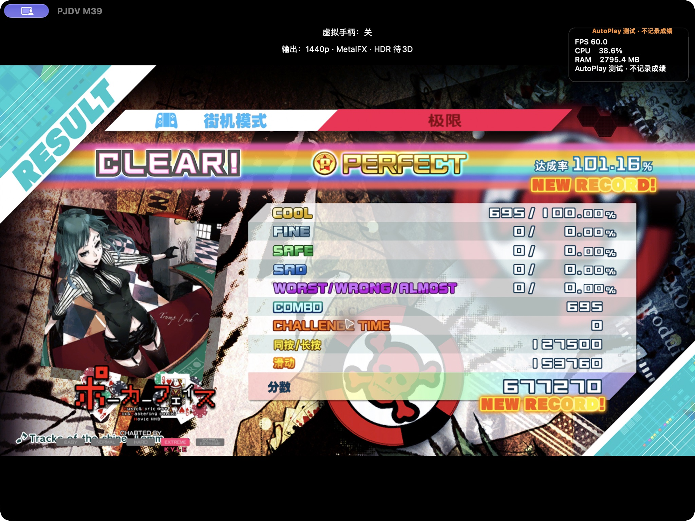

# Eden 完整曲包抽样与清理 / Complete-pack sampling and cleanup

2026-11-01。**build20 之后的本地源码候选，未发布新安装包。** 实际播放测试在 M3 Max Mac Catalyst 版完成，未在 iPad／iPhone 真机或 iOS 模拟器上完成本轮播放验收。

## 完整包与播放结果

Heavy Metal 全部 **14 首／37 个有效谱面**、Rock 全部 **19 首／35 个有效谱面**通过原生谱面检查。开发侧临时重编号、同步封面和数据库，并用项目转换器处理 USM；App 分别导入两个完整开发适配文件夹，再同时加载组合。两份运行清单为 157／185 个文件，合计约 14.16 GB（包括路径别名），合并数据库保留全部 33 个新增编号，实际 EXTREME 列表为 **284 首，原版为 251 首**。

**不是原始 Eden 整包直接导入验收。** 大于 999 的持久编号、升级成绩迁移及 Core／模型／实时 3D／Edit 能力仍待完成。未执行 Windows DLL，未删掉不兼容谱面来凑整包通过。

播放前用固定种子 `full-eden-20261101:<包名>` 各抽两首，均完成 EXTREME 整曲结算。封面、视频和检查到的字幕／音符正常。成绩全部在 AutoPlay 临时档，未上传排行榜；不代替真人同步、正常成绩保存或其他全部歌曲／难度验收。

| 包 | 歌曲（来源 → 临时编号） | COOL／连击 | 分数 | 达成率 |
| --- | --- | --- | --- | --- |
| Rock | 乙女社会距離／少女社会距离（1251 → 817） | 670／670 | 677,430 | 101.18% |
| Heavy Metal | Cosmos（1378 → 812） | 793／793 | 813,290 | 101.31% |
| Heavy Metal | ゲテモノ／怪兽（1362 → 809） | 457／457 | 413,330 | 101.08% |
| Rock | ポーカーフェイス／Poker Face（1335 → 825） | 695／695 | 677,270 | 101.16% |

宿主设置为原生 60 FPS、1440p／MetalFX，沿用 HDR 偏好。源电影自身约 30 FPS，宿主刷新不代表新的真实视频帧。未验收 HDR 准确性或 M1／8 GB 性能。

## 发现、修改及边界

- **Cosmos 初次载入崩溃：** 紧密排列的 1916×1080 画面带有 1920×1088 编码尺寸元数据，AVC 客户端原先要求步长等于可见宽度。现在接受受限的编码步长，保留有效字节数、容量、偏移及尺寸检查，色度转换按可见像素处理；没有裁切或拉伸源画面。包含真实运行时代码的 AVC 测试新增该尺寸、色度与前后哨兵检查，AddressSanitizer 通过，同一视频随后完整结算。初次失败不算通过。
- **Rock pv1244 转换误拒绝：** 合法 IVF 时间基准 `5114000/213043` 超过旧分子上限。现按 CMTime 及时间戳乘法边界检查，零值／溢出／过大分母回归通过。输出为 720p H.264、4,622 帧、192.547 秒；此曲只验证转换，未列入四首播放。
- **第一次启动的存档挂载中止：** 开发 AppData 位于 exFAT，事务存档所需 `clonefile` 不可用。隔离存档及临时目录改放外置 APFS，大曲包／缓存仍在 exFAT；仅显式 Mac 开发目录解析包根路径，包内链接限制保留。未关闭存档事务，未实现正式 exFAT 存档支持。

Mac Catalyst、iOS 真机目标和 Simulator 编译通过；编译不等于实机验收。

其他完整包未标为通过：Dark 的 pv1380 HARD／EXTREME 时间戳倒退；Club Mix 两份、High Octane 三份、Catchy Pop 五份有效谱面未通过；Masochist pv1340 使用尚不支持的头格式。Catchy Pop 还缺 Teto 音频，High Octane／Catchy Pop 有 U+200B 等缺字；Vibes 虽谱面通过，pv1203 歌词所需 ↗ 缺字。未用删曲、换难度或删除字符掩盖失败，也不据此判定源包损坏。

## 存档、来源与清理

隔离原版及组合配置共 **4 个普通存档文件** SHA-256 保持不变。游戏内确认退出后，日志记录存档提交和持久化屏障完成、音频对象及文件／目录／挂载归零，Mac 进程结束；未宣称全部 Metal 共享分配为零。早期崩溃和最终成功日志均保留。

**338 个来源文件引用**重新哈希均一致：Heavy Metal 84、Rock 109、停止准备的 Dark 145。原始 Steam Mod、XCI、游戏基线及正式用户存档未改写或删除。

按要求删除本轮完整开发适配目录、导入副本、组合缓存、部分 Dark 转换及空试验磁盘映像，也删除上一轮 Eden 单曲子集及其导入／组合副本。保留源码、工具、清单、截图、日志及小型隔离存档，无关 exFAT 文件未清理。

实测可用空间增加：Samsung **36.70 GB**，APFS 开发卷 **1.52 GB**，合计 **38.22 GB（35.59 GiB）**。APFS 克隆／硬链接共享内容，目录逻辑大小不能当作回收量。结束时两卷分别约剩 437 GiB／7.9 GiB；后续后台写入仍会改变剩余空间。

详细证据保留于外置开发卷 `Build/FullEden-20261101`：抽样计划、来源哈希、原生预检、运行清单、组合编号检查、视频转换、AVC 检查、编译、结算、存档哈希及两份删除回执。转换资源已删，再次播放需从原始包重新准备。未制作全量包或发布 GitHub。

## English

This unpublished candidate after build20 was played on the **M3 Max Mac Catalyst host**, not physical iPad/iPhone or iOS Simulator. Complete developer-adapted Heavy Metal retained **14 songs / 37 active charts**, and Rock **19 / 35**. Developer preparation temporarily reassigned IDs, synchronized jackets/databases and converted USM with the project converter. The App imported each complete folder independently, then composed both. Manifests contained 157/185 files, approximately 14.16 GB including aliases. Both merged databases retained 33 additions; the actual EXTREME list showed **284 versus 251 native songs**.

This does not establish direct raw Eden import, persistent IDs, score migration, Core/module or real-time 3D/Edit support. No Windows DLL executed. Two songs per pack were selected before playback using recorded seeds. All completed EXTREME: Otome Social Distance **670 COOL/combo, 677,430 points, 101.18%**; Cosmos **793, 813,290, 101.31%**; Bizarre Food **457, 413,330, 101.08%**; Poker Face **695, 677,270, 101.16%**. Results used disposable AutoPlay saves and were never uploaded. Sampled jackets, movies, subtitles and notes looked correct. This is not all-song/all-difficulty, human synchronization or genuine-score acceptance. Host native-60/1440p/MetalFX and existing HDR preferences do not turn approximately 30 FPS source movies into genuine 60 FPS or qualify HDR/M1 performance.

Cosmos initially aborted because packed **1916×1080** output retained **1920×1088** coded stride/slice metadata. The AVC boundary now accepts bounded coded stride while retaining exact visible-byte/capacity/offset/dimension checks. Chroma conversion uses visible dimensions without cropping/stretching. Tests include the real runtime implementation, verify luma/chroma and boundary sentinels under AddressSanitizer, and the same movie subsequently completed. Rock pv1244's valid **5114000/213043 IVF timebase** was also incorrectly capped; CMTime/arithmetic bounds now accept it while zero/overflow/unsafe denominators remain rejected. Its 4,622-frame, 192.547-second 720p conversion passed, but the song was not played. All three platform targets built; physical-device acceptance remains pending.

The first launch also exposed transactional saves' APFS clone dependency when developer AppData was on exFAT. Saves/temp moved to external APFS while packages/cache stayed on exFAT; only explicit Mac developer catalog roots are canonicalized and internal link checks remain. Transactions were not disabled and exFAT save support was not implemented. Dark, Club Mix, High Octane, Catchy Pop, Masochist and Vibes remain blocked by the chart, missing-audio or glyph limitations recorded above. None was made to pass by deleting songs, substituting difficulties or stripping characters; originals are not thereby declared corrupt.

All **four ordinary isolated save files** retained SHA-256. In-game exit completed save commit/durability, released audio/filesystem objects and ended the process; no zero-allocation Metal claim is made. All **338 recorded source references** rehashed unchanged. Original Steam Mods, XCI, baseline and real user saves were retained.

As requested, generated full-pack preparations, installed trial copies, composition cache, partial Dark work, empty trial image and previous Eden single-song generated copies were deleted after testing. Source/tools, manifests, screenshots, logs, small isolated saves and receipts remain. Measured free-space increases: **36.70 GB Samsung + 1.52 GB APFS = 38.22 GB / 35.59 GiB**. Logical sizes do not measure reclaimed APFS shared storage. Volumes ended at about 437/7.9 GiB free. Evidence remains in external `Build/FullEden-20261101`; repeat playback requires regenerating trial assets. No new installer, full bundle or GitHub release was produced.
