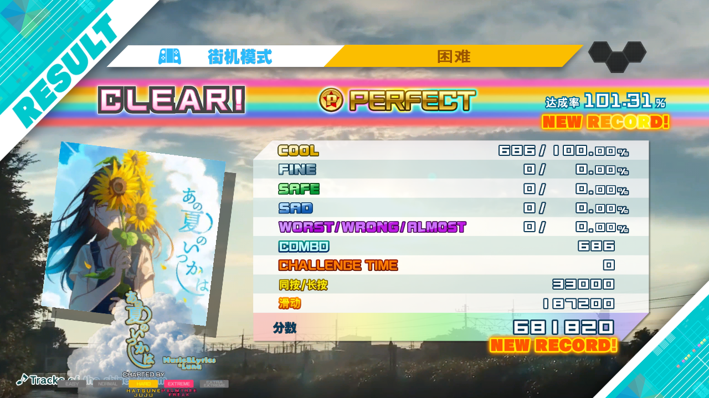
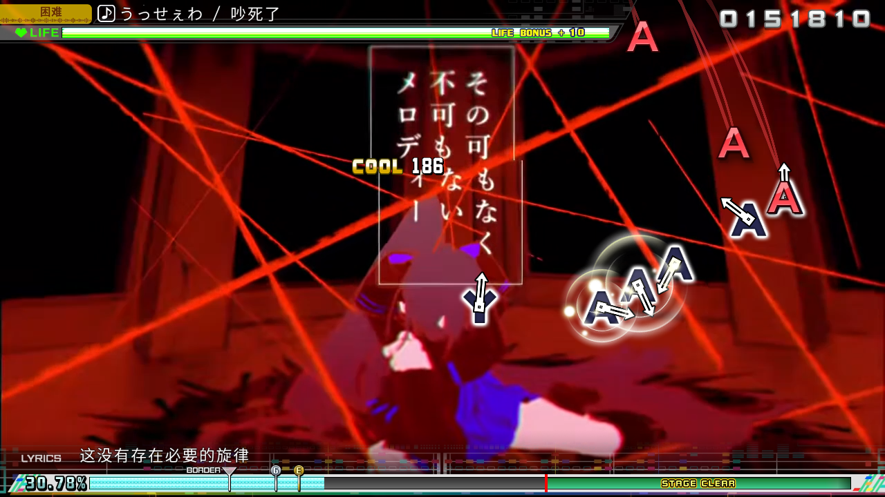
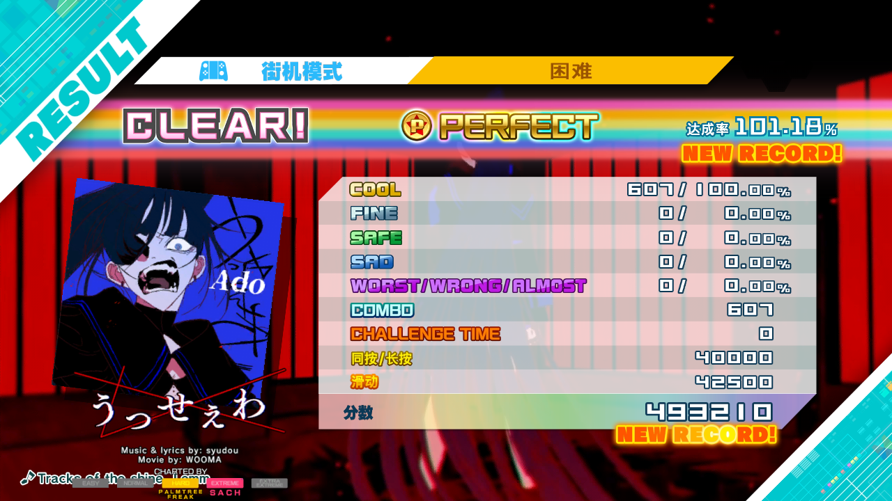
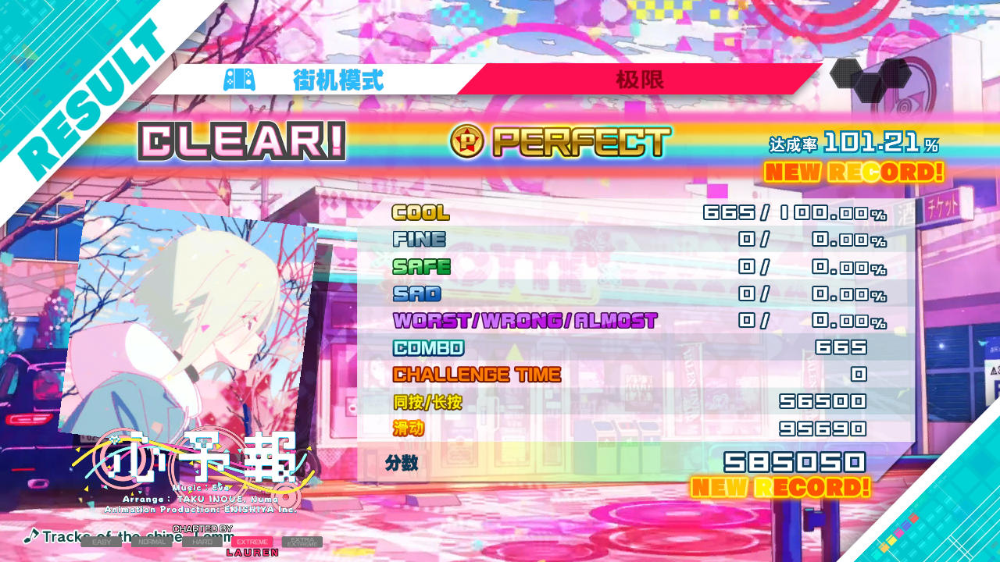
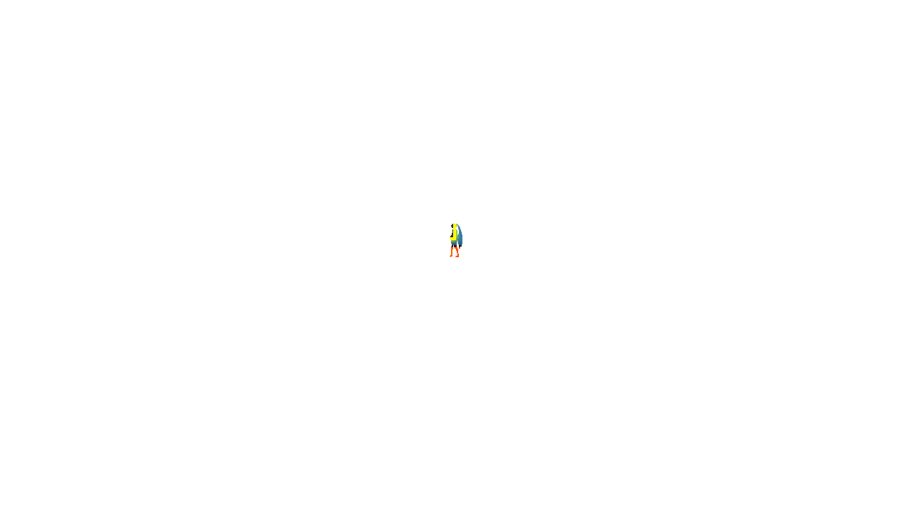
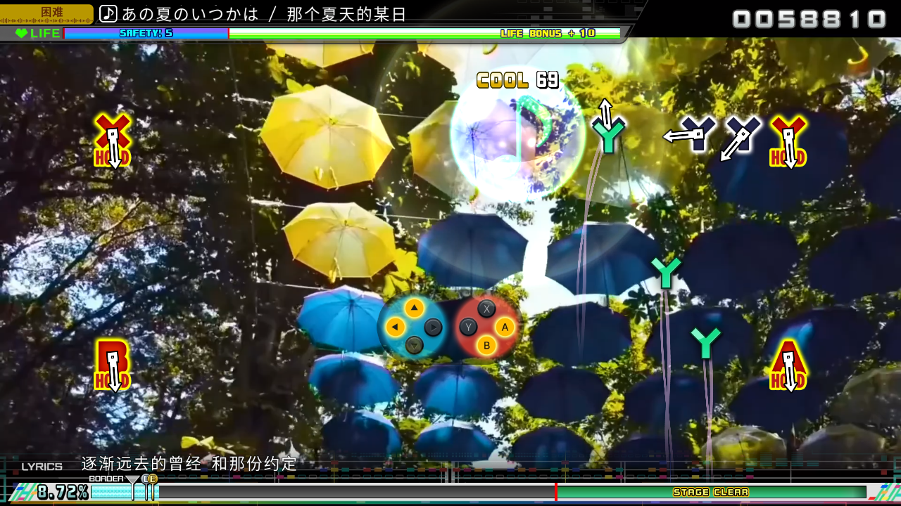

# Eden 单曲转换与组合播放 / Eden single-song conversion and composition

2026-11-01。本地源码候选，公开安装包仍为 build20。本轮使用 **M3 Max Mac Catalyst**；没有将结果当作 iPad／iPhone 真机或低配设备验收。

## 范围

从本地 Eden Beginner、Catchy Pop、Vibes 三包分别取一首，保留原始有效难度、谱面字节、音频、视频内容和封面像素。开发侧临时编号为 800／801／802，并调整排序便于导航；封面归档与名称同步重写。随后由 App 的“添加 MOD 文件夹”分别识别、转换、登记，再多选组合。**这些是开发单曲子集，不是原始完整 Eden 包直接导入，也不是持久编号／升级存档方案。**

| 源包 | 原歌曲编号 → 测试编号 | 样本 | 实际播放难度 |
| --- | --- | --- | --- |
| EdenBeginnerPack | 1013 → 800 | あの夏のいつかは／那个夏天的某日 | HARD |
| EdenCatchyPopPack | 1003 → 801 | うっせぇわ／吵死了 | HARD |
| EdenVibesPack | 1199 → 802 | 心予報／心情预报 | EXTREME |

另外 6 个视频包各一首只做了资源／命令布局检查。Club Mix、Dark、Heavy Metal、High Octane、Masochist、Rock **没有在本轮完整游玩验收**。Core、模型和 3D／Edit 包仍按[存储与接入报告](EDEN-STORAGE-20261101.md)的边界处理，不运行 PC DLL。

## 发现与修改

- 本地 Eden 谱面使用 `0x14050921` 头。只开放与现有常规 FT 命令布局一致、通过边界和命令白名单检查的子集；未知命令、New Classics 和舞台依赖仍拒绝。没有将所有同头文件视为兼容。
- 只按声明的有效难度读取谱面；长度为零的占位引用不要求实际文件存在。有效难度缺文件、异常长度仍失败，不把 HARD／EXTREME 偷换为 NORMAL。
- 当声明的 MP4 不存在时，只接受同路径同名 USM 后缀文件，并继续检查实际媒体。不同名称、越界路径、其他扩展名不回退。
- 初次 Beginner 整曲虽然到达结算，但中文歌词出现方框，开发重编号未同步大封面导致灰图，**初次结果不作为通过**。补上子集的封面名称绑定；运行时将来源提供的常规／粗体中文字库和相应字形映射成对导入，保留原生其他字体。校验旧字覆盖、歌词所需字符、格子几何、重复及越界；没有引入系统字体或替换成不匹配的字体图片。
- 三包单独转换后同时加载，在 `gm_pv_list_tbl.farc` 冲突。新增受限的电影歌曲列表合并：以歌曲 ID 合并新增行，保留原版行、其他属性和归档成员，追加顺序固定；同 ID 不同内容、删除／改写原版、未知归档成员变化都拒绝。组合缓存修订为 `native-composition-8`，避免继续使用旧组合。

## 验证与证据

歌曲解析／字体与组合回归通过：包括缺失有效谱面、非法命令、精确媒体回退、字形缺失／重复／截断、两个独立列表、反向选择、相同条目去重、编号冲突、原版删除／改写、未知归档成员变化、取消和失败恢复。三个实际转换包的离线组合检查通过，App 内也显示“已启用 3 个 MOD”并进入选曲。Mac Catalyst、iOS Simulator、iOS 真机目标均编译通过；编译通过不等于真机测试通过。

三个包同时启用，在同一游戏会话内依次完成以下整曲结算。封面、字幕与视频在检查的镜头中正常；没有将分项抓帧称为逐帧画质或真人音画同步验收。

| 样本／难度 | COOL／连击 | 测试分数 | 达成率 |
| --- | --- | --- | --- |
| 那个夏天的某日 HARD | 686／686 | 681,820 | 101.31% |
| 吵死了 HARD | 607／607 | 493,210 | 101.18% |
| 心情预报 EXTREME | 665／665 | 585,050 | 101.21% |

全部为 **AutoPlay 临时成绩**，没有上传排行榜。测试后，原版及两套组合配置共 6 个普通存档文件仍与种子 SHA-256 一致；成绩写在 AutoPlay 临时目录。游戏内退出确认后 Mac 进程正常结束，冷启动页仍显示三包已启用。再停用所有 MOD、加载并启动原版，中文标题／主菜单正常，HARD 恢复 251 首，Eden 两首 HARD 样本不再出现在《愛言葉》后的列表中；随后正常退出，6 个普通存档哈希仍不变。这不能代替正常成绩保存、包升级与编号迁移测试。

### 本机显示计时

保留的 JSONL 以首次至末次诊断输入界定区间，不含载入、无音符尾奏与结算；不是三首完整 PV 的端到端平均。宿主输出设置为 1440p／MetalFX、原生 60，无插帧。HDR 开关沿用测试偏好，但本轮没有进行 HDR 准确性对照。CPU 100% 表示一个 CPU 核心满载。

| 区间 | 时长 | 显示间隔 P95／P99 | 最长间隔 | App 内存峰值 |
| --- | --- | --- | --- | --- |
| Beginner HARD，含一次渲染抓帧 | 244.0 s | 16.671／16.672 ms | 275.00 ms | 2551.8 MiB |
| Catchy HARD，含一次渲染抓帧 | 199.5 s | 16.671／16.672 ms | 283.34 ms | 2660.1 MiB |
| Vibes EXTREME，曲中无渲染抓帧 | 196.0 s | 16.671／16.673 ms | 25.00 ms | 2815.8 MiB |

三个区间显示 FPS 中位数均约 60。前两项的长帧分别与 8793、40265 帧的渲染读回请求重叠，保留在统计中；第三首无曲中读回。此对照支持继续隔离诊断开销，但不是同曲 A/B 因果证明，也不能保证所有曲目无停顿或 M1／8 GB 设备性能。连续切歌占用上升，需要更长时间的资源回收测试，未宣称无泄漏。

转码输出的实际视频平均帧率分别约 **29.97、20、23.98 FPS**；宿主 60 FPS 不等于视频获得新的真实 60 帧。输出媒体分别为 1080p、720p、1080p；场景抓帧为游戏内部 1280×720。未修改原始 Steam 包或 XCI；用到的 33 个来源文件引用已重新哈希，保持原字节。开发卷测试结束时约剩 6.6 GiB，没有再次生成全量包或发布到 GitHub。

初次失败与修复后的中文歌词抓帧：

上述场景抓帧是游戏渲染结果，不包含宿主 MetalFX／HDR 后的最终显示，不能据此宣称 HDR 正确或源视频升为真实 60 FPS。视频与谱面是不同刷新来源；AutoPlay 只验证运行和结算，不代替真人输入、音画同步或长期成绩迁移验证。

## English

This is an unpublished source candidate after public build20, tested on the **M3 Max Mac Catalyst host**, not physical iPad/iPhone or low-end hardware. Three developer-only one-song subsets were prepared from Eden Beginner, Catchy Pop and Vibes: source IDs 1013/1003/1199 temporarily became 800/801/802, with synchronized jacket labels and private navigation order. Active HARD/EXTREME chart bytes, media content and image pixels were preserved. The App converted each folder independently, then selected and composed all three. **This does not establish complete raw Eden-package import, persistent ID allocation or save-upgrade compatibility.** The other six movie-pack samples received structural preflight only; Core, modules and real-time 3D/Edit capabilities remain separate work. No Windows DLL ran.

The song adapter now accepts the validated common-command subset with the native DSC header, follows active difficulty declarations, and resolves a missing declared MP4 only to its exact same-name USM sibling before media validation. Unknown commands, unsupported mechanics and missing active charts still fail. The first full Beginner run reached results but had missing Chinese glyphs and an incorrectly bound jacket in the developer fixture, so it was not accepted. Paired source-supplied CJK atlases/maps now preserve native glyph coverage and cell geometry; missing/duplicate/truncated glyph data is rejected. Fixture jacket labels were synchronized without changing pixels.

Three independent converted song packs exposed a playlist-FARC collision. The composition candidate now merges supported movie-song additions by ID, preserves native records and opaque members, sorts additions deterministically, and rejects conflicting IDs or baseline/unknown-member modifications. Composition revision 8 invalidates prior caches. Parser/font/composition regressions and actual offline composition passed. The App displayed three enabled Mods and entered song selection. Mac Catalyst, Simulator and iOS-device-target builds passed; this is not physical-device acceptance. Captures above are game-scene output before host MetalFX/HDR. AutoPlay uses disposable saves and is not evidence of human input/synchronization, genuine 60 FPS video or long-term score migration.

All three samples completed sequentially in one three-pack session: Beginner HARD **686 COOL/combo, 681,820 points, 101.31%**; Catchy HARD **607 COOL/combo, 493,210 points, 101.18%**; Vibes EXTREME **665 COOL/combo, 585,050 points, 101.21%**. These are temporary AutoPlay results; none was uploaded. All six ordinary save files across the original and two composition profiles retained their seed SHA-256 hashes. The in-game exit confirmation ended the Mac process normally; cold launch retained the three selected packages. Normal-score persistence, upgrades and ID migration remain separate acceptance gates.

Disabling all Mods and starting again restored the native Chinese title/main menu and 251-song HARD list, with no Eden HARD additions following Ai Kotoba. A second normal in-game exit completed, and all six ordinary-save hashes remained unchanged.

Presentation timing between first and last diagnostic inputs covered 244.0/199.5/196.0 seconds, excluding loading, note-free outros and results. All medians were about 60 presented FPS at the host's 1440p/MetalFX native-60 setting. P99 intervals were approximately 16.672/16.672/16.673 ms. Maximum intervals were **275.00/283.34/25.00 ms**; the first two overlap their in-song GPU readbacks, while Vibes had no in-song readback request. This is not a same-song controlled A/B or a guarantee of stall-free/low-end performance. App footprint peaks were 2551.8/2660.1/2815.8 MiB; rising footprint across three songs needs longer resource-reclamation testing. No leak-free claim is made. Actual converted movie rates were about **29.97/20/23.98 FPS**, at 1080p/720p/1080p; host presentation did not generate new genuine video frames. Internal scene captures are 720p, and HDR accuracy was not qualified. All 33 used source-file references rehashed unchanged. Original Steam packages and XCI were retained; approximately 6.6 GiB remained on the development volume. No full installer or GitHub release was produced.
