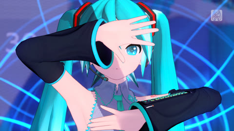
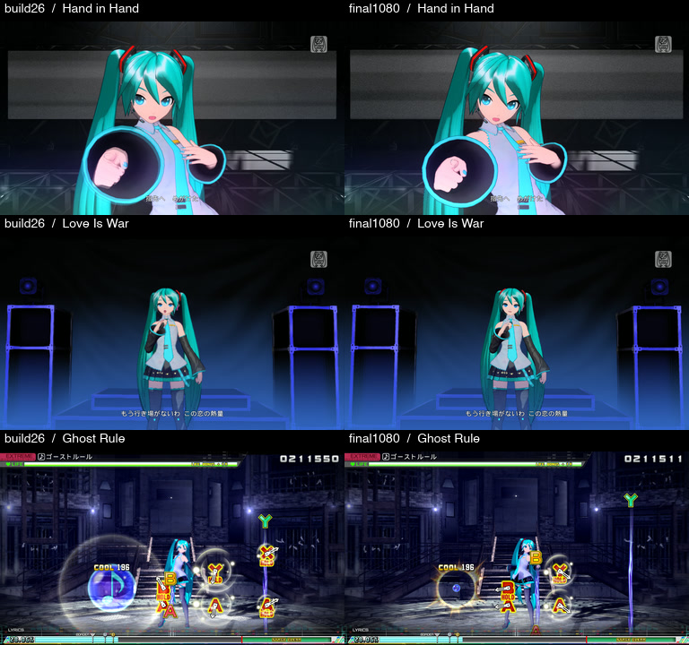
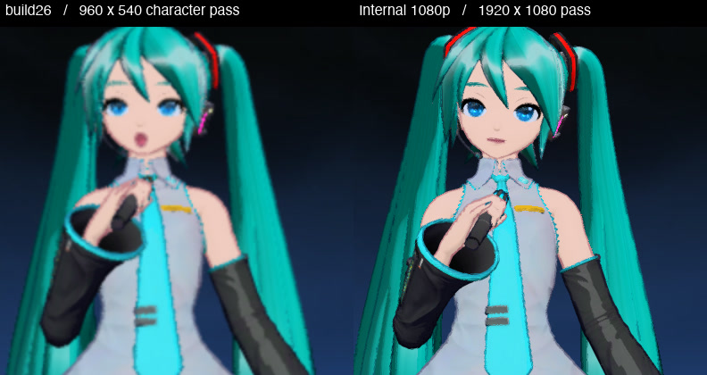

# 内部 1080p 实验 / Experimental internal 1080p

2026-11-25 · build27 发布说明。画面与性能数据来自同一渲染代码的发布前候选。 / Build 27 release notes. The visual and performance samples were captured on the pre-release candidate with the same rendering code.

## 开启与画面

启动页 → 画质 → **内部 1080p 渲染（实验）**，然后启动游戏。选项默认关闭，选择会保存；显示输出分辨率和 MetalFX 可分别设置。退出游戏回到启动页后可以更换下次会话的设置。

实验让兼容的主场景颜色、深度和最终合成目标使用 1920×1080 Metal 纹理，并换算绘制视口、裁剪和窗口取样范围。在游戏提前读取色调映射和抗锯齿纹理时，先保留已有内容再升档。阴影图和缩小的辉光等中间效果仍使用游戏指定的分辨率。只有已经识别的日版 v1.0.9 歌曲参数会调整开场绘制比例，Mod 提供的同名参数优先；其他镜头的有效分辨率取决于游戏的设置。

## 模拟器抽测 / Simulator spot checks

宿主为 M3 Max，使用 11 英寸 M5 iPad Pro 模拟器、日版 v1.0.9 原始资源、默认服装、自动画质、1080p 普通输出、原生 60 FPS。HDR、光追和插帧关闭。两首 PV 在选曲确认后约 30–46 秒取样；《ゴーストルール》使用隔离 AutoPlay 存档在 EXTREME 实际打歌，取首次判定后的第 11–56 秒。抓图安排在计时窗口外。表中帧率按显示帧间隔计算，PV 仍可保留歌曲原有的 30 FPS 动画节奏。

Tests ran on an M3 Max hosting the 11-inch M5 iPad Pro simulator, using matching stock JP v1.0.9 assets, default costumes, automatic quality, ordinary 1080p output and native 60 FPS. The two PV windows were sampled about 30–46 seconds after confirmation. An isolated AutoPlay save played Ghost Rule EXTREME for the 45-second window starting 11 seconds after the first judgement. Screenshots were taken outside the measured windows. Display FPS includes presentation of the original animation cadence.

| 曲目 / Song | 人物实际视口 / Character viewport | 平均显示 FPS / Avg | P95 帧间隔 / ms | 最长帧 / ms | 进程内存峰值 / MiB |
| --- | --- | ---: | ---: | ---: | ---: |
| Hand in Hand | 1280×720 → 1920×1080 | 60.01 → 60.01 | 18.17 → 20.37 | 41.38 → 38.22 | 639 → 602 |
| 恋は戦争 / Love Is War | 960×540 → 1920×1080 | 60.01 → 60.00 | 19.48 → 19.08 | 21.71 → 23.57 | 635 → 604 |
| ゴーストルール / Ghost Rule · EXTREME | 880×495 → 1920×1080 | 60.00 → 60.00 | 18.93 → 19.37 | 26.82 → 24.31 | 802 → 790 |

箭头从公开 build26 到实验版本。每格为一次短窗口测量。《Hand in Hand》基线短窗口与另一次本地构建有重叠，先前单独抽测同曲也在约 60 FPS。峰值内存受缓存和运行阶段影响，不能据此推算设备内存增量。

Arrows run from public build26 to the experimental build. Each entry is one short measurement. The Hand in Hand baseline overlapped a local build; previous independent measurements of the song also averaged about 60 displayed FPS. Process memory peaks include caches and depend on execution timing.

四首歌均抓到了从人物、舞台颜色和深度，到色调映射、FXAA 和最终合成的完整 1920×1080 绘制链。对应抓帧为《Hand in Hand》F4965、《恋は戦争》F8968、《ゴーストルール》F15737，以及《39みゅーじっく！》开场捂脸镜头 F7186。第四首仅核验画面。独立启动页测试确认，默认关闭，手动开启并重启后仍勾选，游戏源图为 1920×1080；关闭再重启后，游戏源图恢复为 1280×720。

We traced character and stage color/depth, tone mapping, FXAA, and the final composite at 1920×1080 in all four captures. The fourth song, “39 Music!”, was a visual spot check of the opening shot where Miku covers her face. The launcher test used the same executable with isolated preferences. The option defaulted to off, survived restart when enabled, and produced a 1920×1080 game source. After disabling it and restarting, the source returned to 1280×720.

《恋は戦争》的两张近景裁自相同的归一化区域。旧版源图用双线性插值放大到相同的比较尺寸；右侧取实验版的实际 1080p 源图。两张图里的嘴形略有不同。

同一首歌的截图取自独立播放，镜头时间可能不同。实际绘制尺寸由每次绘制的 Metal 颜色和深度附件、有效视口、最终游戏源图交叉核对。iOS、iOS 模拟器和 Mac Catalyst 的 Release 配置均已编译。此次游戏抽测未测 iPhone 或 iPad 真机的持续帧率、温升或真人输入延迟。

## Using the option

In the launcher, open **Quality → Internal 1080p Rendering (Experimental)** and start the game. The setting defaults to off, persists across launches and is independent of output resolution and MetalFX. It takes effect when a game session starts. Supported main color and depth attachments and the final composite use 1920×1080 backing textures, with matching viewports, scissors and presentation crops. Lower-resolution shadow and glow passes retain their original sizes. Matching stock song parameters can also raise the opening character viewport; dynamic scenes and Mod overrides can still select a smaller viewport.

The “Love Is War” detail comparison uses the same normalized crop from both runs. The build26 image is bilinearly enlarged onto the same comparison grid, while the candidate crop uses its 1080p source. Screenshots come from independent runs, so poses and camera timing may differ. Resolution checks use Metal attachment sizes, effective viewports and the saved presentation source. The iOS, iOS Simulator and Mac Catalyst Release targets compiled. Sustained physical-device frame times, thermals and human input latency were outside this simulator check.
