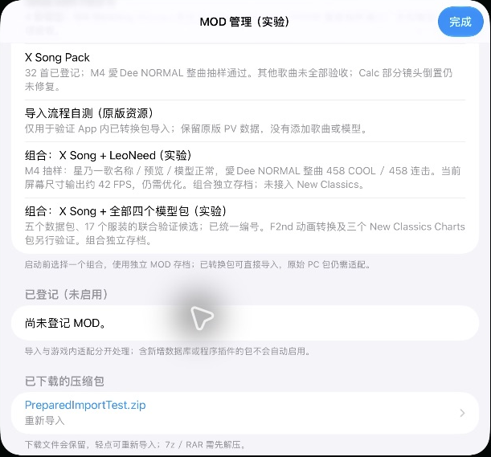
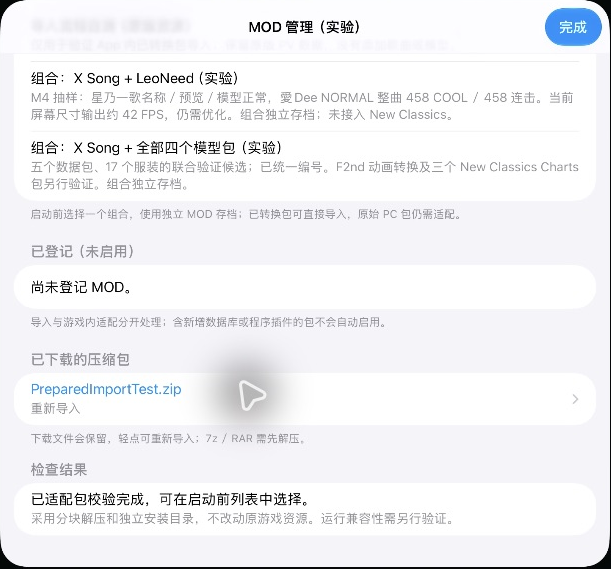
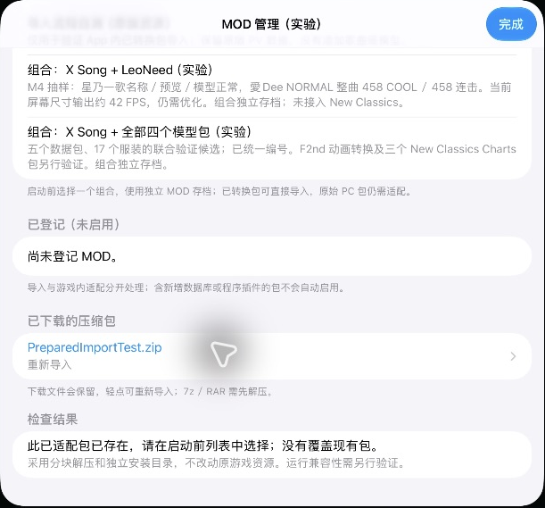

# 无需 Xcode 的 MOD 工作流 / MOD workflow without Xcode

2026-10-29，更新于 2026-10-30。用户要求：普通用户应能在 App 中导入几个 MOD 并组合使用，不需要编译 App、执行转换脚本或手工改编号。此文区分当前候选与后续验收要求。

## 当前候选

- 已有 ZIP／文件夹的分块安装、ZIP CRC、取消和独立目录；PC DLL 不执行。
- 本轮增加 `RuntimeModCatalog.adoptPrepared`：导入根目录含 `runtime.json` 的已转换包，也接受 ZIP 的单层外目录。核对完整清单，所有媒体分块 SHA-256 校验通过后，才将安装副本原子移入 Ready。漏文件、额外文件、损坏内容、符号链接和重复包不会覆盖既有组合。导入不自动切换当前组合。原始 ZIP 保留。
- 当前清单格式仍是 `pjdv-runtime-mod-v1`。其中的多个 layer 是**同一个已合并组合内部**的搜索层，不表示任意完整数据库可以直接叠加。资源基线指纹仍在启动前检查。
- 没有已转换清单的 PC 包仍登记为未启用；不会把“解压成功”显示为“可以运行”。
- 本轮五包合并仍在电脑端研究并制作候选。**App 内通用 PC 转换器、任意多选合并和 New Classics 玩法尚未完成。** 新入口已通过组件测试、iOS 编译与下述 M4 导入抽样；尚未导出／发布新安装包，不与旧 build19 混同。

## M4 App 导入验收（2026-10-30）

通过 App 的“已下载的压缩包”点击一个带单层外目录的已适配 ZIP。App 自行解压、校验并加入启动前列表；回读 `runtime.json` 和全部测试载荷，大小与 SHA-256 一致。原 ZIP 保留，当前 LeoNeed 组合选择未被改变。再次点击同一 ZIP，显示已存在、不覆盖；原已安装内容再次回读一致。两份普通存档哈希未变化。

这份小型自测包仅含原版 PV 元数据副本，不增加歌曲或模型；用于验证完整安装路径，**不是 3.4 GB 五包转换或 8 GB M1 内存压力验收**。私有载荷不上传。

测试发现并修复 `/var` 与 `/private/var` 等祖先路径别名的误报：先拒绝所选符号链接，再统一枚举路径。新增完整“文件夹安装→已适配包登记”的别名回归测试；原有 CRC、路径越界、损坏清单、取消、重复保护及 256 MiB 流式解压测试通过。

## 普通用户的目标操作

下载 ZIP／选择文件夹 → App 自动识别和转换 → 勾选多个包 → 处理必要的内容选择 → 启动游戏。兼容组合应直接启动；不可兼容的内容说明具体包名和原因，不要求用户安装 Xcode。

## 自动合并的验收要求

| 情况 | App 必须采取的行为 |
| --- | --- |
| 两包碰巧复用同一个对象／纹理／服装／模块编号 | 按包的稳定身份分配全局编号，同步修改所有引用；不能靠加载顺序覆盖。 |
| 同名且完整内容一致的共享模型／贴图 | 内容校验后可共用；压缩方式或旧编号不同不能单凭压缩文件哈希断言相同／不同。 |
| 两包使用相同名字、内容却不同 | 可以完整改名及引用时自动隔离；否则显示冲突并让用户二选一。 |
| 两包都带完整 sprite／object／item／字符串数据库 | 取相对游戏基线的语义差量合并，保留各地区实际读取的路径；不能整表最后覆盖。 |
| 同一 FARC 只替换部分动画或精灵条目 | 合并条目，保留原有未替换条目及动画曲线。 |
| 相同歌曲／不同谱面版本 | 身份包含歌曲、难度、edition、玩法风格；不能把不同版本误认作重复文件。无法共存时提供明确选择。 |
| 缺依赖、依赖循环、版本不符或玩法核心未实现 | 显示缺项；缓存资源但阻止该组合启动，不伪报 New Classics 可用。 |
| 启用、停用、升级、卸载或安装中断 | 在暂存目录生成新组合，验证后整体切换；失败保留上一次可用组合。每个组合存档隔离，稳定编号不随勾选顺序漂移。 |

安装与转换应单任务串行，流式复制媒体、逐个 FARC 转换，限制展开量和元数据规模，提供阶段／进度／空间不足提示。需要实测 8 GB M1 的峰值内存及中断恢复，不能用 M4 通过代替。

## English

The intended user workflow is **download/select → in-App detection and conversion → select several MODs → resolve real incompatibilities → launch**. Xcode, command-line tools and manual ID edits must not be required.

This candidate adds native adoption of **already converted** packages containing `runtime.json`, including a single enclosing ZIP folder. The complete inventory and every payload hash are checked with bounded reads before an atomic move into Ready. Missing, extra or corrupt files, symlinks and duplicate IDs do not replace an installed package. Import does not change the selected combination. Raw PC packages remain inactive registrations.

The existing v1 manifest describes one prepared combination, whose internal layers are not a general-purpose merger. The five-package composition remains an offline research candidate. **General in-App PC conversion, arbitrary multi-selection/merging and New Classics gameplay are not implemented.** Component tests and an iOS build passed; no new public installer has been exported/released.

On the M4, tapping a wrapped prepared ZIP in the App's downloaded archive list completed extraction, validation and native registration. The installed manifest and every test payload matched full readback hashes. The original ZIP and selected LeoNeed combination were preserved. Reimporting the same ZIP reported a duplicate without overwriting the installed payload. Both normal save hashes remained unchanged. This small fixture contains only original PV metadata; it does not qualify general conversion, the full 3.4 GB combination or memory on an 8 GB M1. Private payloads are not published.

The physical trial exposed an ancestor-alias path mismatch (`/var` versus `/private/var`). Enumeration now uses consistent canonical paths after rejecting a selected symlink. A complete installer-to-catalog alias regression test passes alongside CRC/path/corruption/cancellation/duplicate checks and streamed 256 MiB expansion.

The final merger needs stable package identities and global ID allocation across objects, textures, costumes, modules and sprites; all references must be updated. Shared content may be deduplicated only after semantic content checks. Different content with the same name needs complete namespacing or an explicit user choice. Merge database deltas against the actual game baseline, including regional/DLC lookup paths, and retain inherited FARC entries and animation curves.

Chart identity must include song, difficulty, edition and gameplay style. Check dependency versions and cycles, and reject unsupported gameplay capabilities before launch. Generate and verify a new combination transactionally, preserve the last working version on failure, keep combination saves isolated, and do not let IDs drift with selection order. Stream media and process archives serially with bounded expansion; validate memory and interruption recovery on an 8 GB M1 separately.
