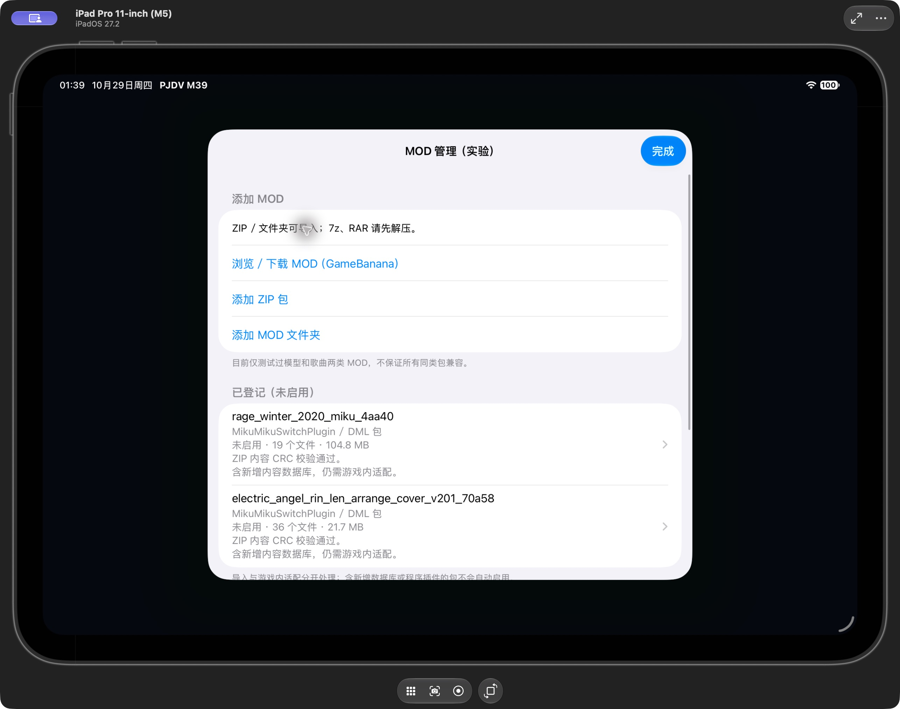
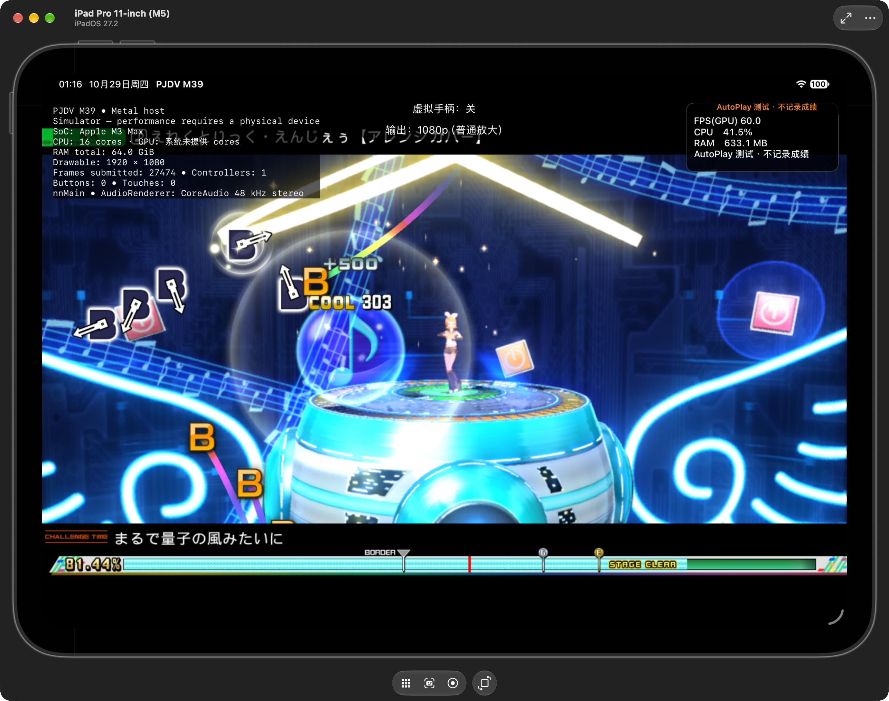
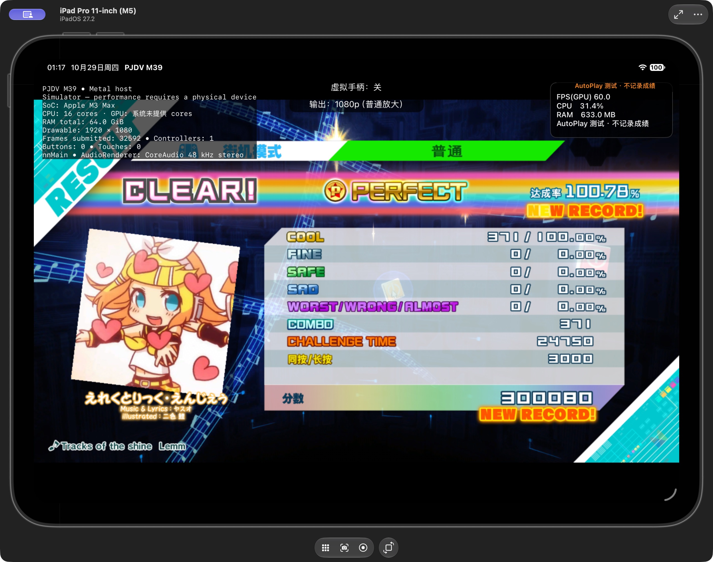
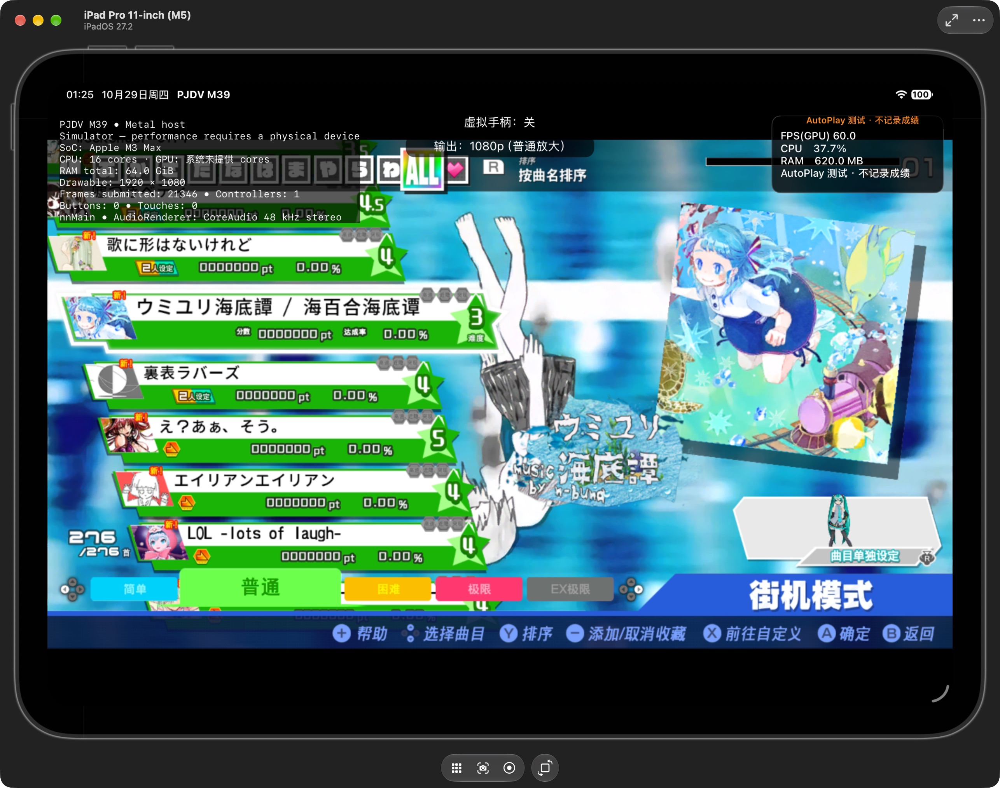
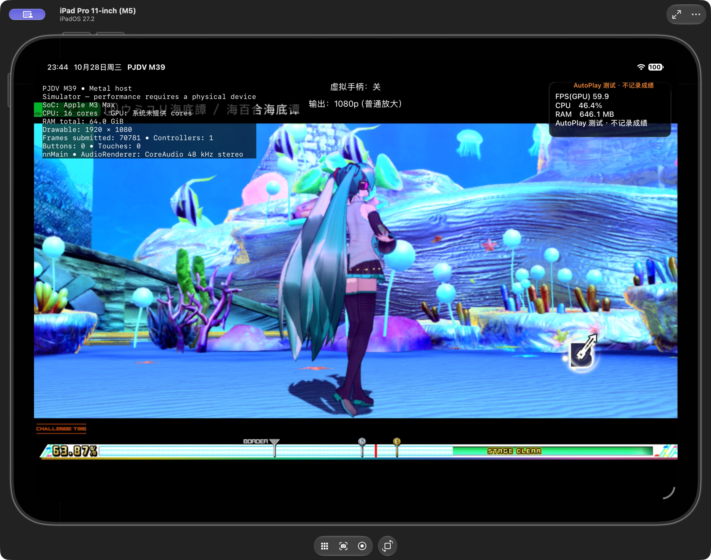
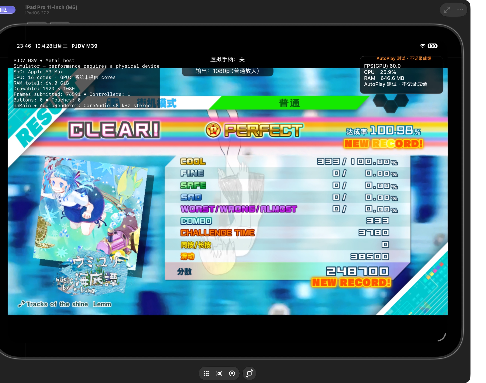
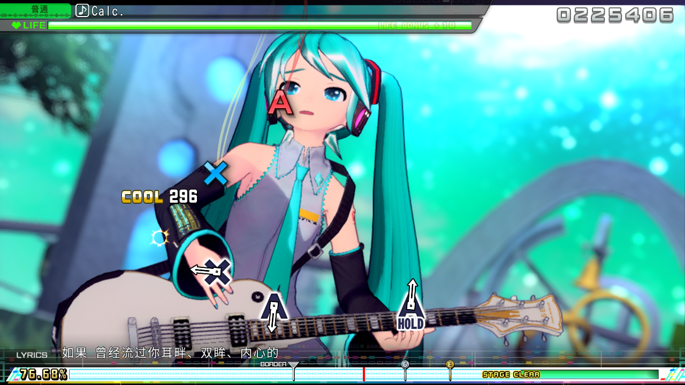

# MOD 下载、导入与本地转换验证 / MOD download, import and local conversion

2026-10-29。研究候选源码与测试记录；**本报告不代表新安装包已发布，也不代表任意 PC MOD 可直接运行。**

## 实际下载的两个样本

| 类型 | 作者来源 | 下载与 App 导入 | 游戏验证 |
| --- | --- | --- | --- |
| 模型 | arvo：[Rage Winter 2020 Miku](https://gamebanana.com/mods/608087) | ZIP 103,638,369 B；19 文件，展开 104,811,283 B；CRC 通过 | 下载资源经本地转换得到的 16 个输出与前一轮成功配置逐字节相同；前一轮已验证服装预览及《愛言葉》完整实时 PV。没有把这次校验冒充新的完整 PV 回归。 |
| 歌曲 | ArcadeGamer1929：[Electric Angel (Rin & Len Arrange Cover)](https://gamebanana.com/mods/417011) | ZIP 19,752,286 B；36 文件，约 21.7 MB；CRC 通过；下载 MD5 与作者元数据相同 | 转换后单包加载 PV237；NORMAL 完整结算：371 COOL、371 连击、100.78%、300080 分。抽查角色、舞台、日文歌词、大小封面。尚未完成所有镜头及双人表现的原版逐镜头对照。 |

两次下载均实际经过 App 内置浏览器，不是只在电脑上下载后声称 App 功能已通过。进入 MOD 管理后打开 GameBanana，默认目录为 [Mega Mix+ MOD catalog](https://gamebanana.com/games/16522)。下载完成自动进入解压／校验，失败的原压缩包保留在“已下载的压缩包”中，可重试导入。

**App 导入后仍登记为“未启用”。** 通用 MOD 运行接口尚未启用；下面的游戏测试通过启动前指定的独立只读覆盖层完成。没有运行 PC DLL、EXE 或 Switch 插件。

## 如何复用本地代码转换

可复现工具：[Tools/pc_mods](../Tools/pc_mods/README.md)。输入是自行提供的已提取原游戏、DLC 和单个已解压 MOD，输出必须是新的独立目录。原游戏、XCI、源 MOD 不修改，转换资源不上传。

- 模型 profile 复用对象／纹理数据库合并、材质贴图 ID 同步、服装部件和 skin／osage 表处理。保留网格、法线、蒙皮及纹理数据。当前仅在测试层替换 Miku 默认服装，不是正式新增服装槽。
- Electric Angel 的 Auth3D `6611024–6611028` 映射到 `11406–11410`，避免分配数百万空条目；只改舞台 Auth3D 数组中的对应字段。
- PC 舞台登记槽 246 已被 Switch 占用，分配新槽 1027。舞台对象引用保持不变。参考作者的 [Switch 版本](https://gamebanana.com/mods/434532) 可确认舞台对象字段一致；完整参考包 MD5 为 `d2b02c9da548793ec023ef9738067e39`，与作者元数据相同。没有把参考包资源混入 PC 转换输出。
- 精灵编号紧凑化，并同步 AET 的 VideoSource 精灵字段。按结构定位，不全文件搜索替换整数。
- 缩略图合并保留原来 258 个 sprite、4 张纹理及其数据，仅追加新歌曲所需图块；合并 PV、动作和菜单数据库，保留原记录。
- `thumbnail_merge.py` 按 MikuMikuLibrary 的 [SpriteSet](https://github.com/blueskythlikesclouds/MikuMikuLibrary/blob/master/MikuMikuLibrary/Sprites/SpriteSet.cs)、[Sprite](https://github.com/blueskythlikesclouds/MikuMikuLibrary/blob/master/MikuMikuLibrary/Sprites/Sprite.cs)、[TextureSet](https://github.com/blueskythlikesclouds/MikuMikuLibrary/blob/master/MikuMikuLibrary/Textures/TextureSet.cs) 格式实现读写及保留性检查。

以上成绩来自实验性 AutoPlay，**不是真实游玩成绩**。正式 GuestSave 文件数前后均为 0；每个测试会话使用独立临时存档，成绩不合回。

## X Song Pack 本轮修复与限制

| 项目 | 验证范围 |
| --- | --- |
| 新歌曲封面／标题 | 爱Dee、海底谭大封面和标题实际显示。海底谭左侧小封面也已重新进游戏验证，不再用大封面通过代替小封面通过。 |
| 简体中文缩略图 | 原因是游戏独立读取 CN／TW 共享缩略图，而此前只覆盖默认图集；现将扩展图集与默认／CN／TW 路径配对。 |
| 中文字体和歌词 | 只配对包内已有的 fontmap 15／17 与对应扩展图集，保留其他原字体表。检查 43 个本体／DLC／MOD PVDB，没有发现歌词缺字；实际验证海底谭简体中文歌词。未打包 Apple 系统字体或下载额外字体。 |
| Strangers | NORMAL 完整结算：326 COOL，100.81%。 |
| 海底谭 PV807 | NORMAL 完整结算：333 COOL、333 连击、100.98%、248700 分；人物和海底舞台实际可见。 |
| Calc PV814 | 本轮也跑到 NORMAL 结算，实际抓帧中简体中文歌词完整显示；**部分镜头仍上下倒置**。同次会话亦有方向正常的渲染帧，不能用单张正常图宣称全曲修复。 |
| X Charts Pack | 官方 1.1.1 下载与本地脚本匹配；依赖 New Classics 的扩展判定／长星键／计分。当前仍不启用，不能仅复制脚本或丢弃新字段。 |
| 全部 32 首 PV | 仅完成资源登记和抽样；不代表所有曲目全流程通过。视频型 PV、复杂特效、歌词和服装组合仍需逐项验证。 |

模型的上一轮详细记录：[单模型测试](MOD-RAGE-WINTER-20261028.md)。

## 解压资源占用与回归检查

下载使用磁盘下载任务，ZIP 解压采用单个低优先级串行任务、64 KiB 数据块，不一次载入整个压缩包。进度显示当前文件、展开字节及速度，支持取消。单下载上限 16 GiB，单包展开上限 32 GiB；预检查空间并在写入过程中复查。7z／RAR 仅保留下载，需先在外部解压后导入文件夹。

真实模型包暴露了一个边界错误：某个 64 KiB 输出块恰好耗尽输入时，zlib 的后续 `Z_BUF_ERROR` 被错误当成损坏。已修复该状态，并以原下载包重新导入成功；未放宽 CRC、实际长度、路径及压缩流边界检查。

合成回归通过：stored／deflate／ZIP64、4 MiB 不可压缩边界、256 MiB 流式展开、CRC 错误、路径穿越、符号链接、头部不匹配、大小上限和取消清理。测试子进程峰值 RSS 约 **10.7 MiB**，这是解压器测试值，**不是整个游戏的 RAM 峰值**。源 ZIP 校验值保持不变。模拟器和 Mac Catalyst Release 构建通过。

离线 FARC 转换与 App ZIP 导入是不同路径：转换逐个 FARC 处理，编码档上限 128 MiB、单条展开 256 MiB、单档累计 384 MiB。不会宣称转换进程只有两个 64 KiB 缓冲区。

所有运行截图来自 M5 iPad 模拟器，实际宿主为 M3 Max / 64 GiB Mac。显示约 60 FPS **不能视为 M1／M4／M5 真机性能结果**。本次没有进行真机或长时间泄漏验收。

## English

This is a research source candidate, **not a new installer release or a universal PC MOD compatibility claim**. Both a model and a song were downloaded through the App's own browser, extracted on disk and CRC-validated. Imports remain inactive; isolated game trials use a fixed read-only overlay selected before launch. No PC DLL/EXE or Switch plugin is executed.

The model sample is arvo's Rage Winter 2020 Miku: a 103,638,369-byte ZIP, 19 installed files and 104,811,283 expanded bytes. Its offline converter produces 16 files identical to the previously validated outfit profile. That earlier profile displayed customization and completed the real-time Ai Kotoba PV. Byte equivalence is reported separately from a fresh complete runtime regression. The experiment replaces costume 0; it does not add a new costume menu slot.

The song sample is ArcadeGamer1929's Electric Angel (Rin & Len Arrange Cover), PC v2.0.1: a 19,752,286-byte ZIP and 36 installed files, with matching author MD5. The converted PV237 completed NORMAL with **371 COOL, 371 combo, 100.78%, 300080 points**. Selected shots showed a character, stage and Japanese lyrics; both cover sizes appeared. All-shot camera/duet visual parity remains unaccepted. AutoPlay results use a disposable save and are not real scores; the normal save remained empty.

The converter reuses local database/FARC readers and the earlier model/X Song adapters. It compacts five Auth3D IDs from 6611024–6611028 to 11406–11410, relocates the colliding stage registry slot 246 to 1027, preserves stage object references, remaps sprite IDs at documented AET fields, and merges the PV/motion/menu tables. The new thumbnail merger preserves all 258 original sprites and four textures, appending only the new content. Author Switch metadata was used for comparison; no reference-game assets were mixed into the converted PC output. All downloaded/converted assets stay local.

X Song's Strangers and Umiyuri Kaiteitan completed NORMAL (326 and 333 COOL respectively). Umiyuri's large cover, title, **small list thumbnail** and Chinese gameplay lyrics were visually verified. The small-thumbnail failure came from independent CN/TW atlas paths; those are now paired with the expanded registry. Only supplied font maps 15/17 and their atlases are paired; an audit of 43 base/DLC/MOD PVDBs found no missing lyric characters. No Apple system font or external font package is bundled. Calc also reached the result screen; captured Chinese lyrics were readable. **Some Calc shots remain inverted**, while another captured frame was upright; a single good frame is not whole-song acceptance. **X Charts stays disabled because its New Classics mechanics are not integrated.** Registration of all 32 X Song tracks is not full acceptance of every PV.

The importer uses one serial utility worker and 64 KiB chunks, streamed disk downloads, CRC/size/path checks, cancellation cleanup and free-space checks. Limits are 16 GiB per download and 32 GiB expanded per package. Extract 7z/RAR externally first. A real model ZIP exposed an exact-buffer zlib boundary bug; the fix retains integrity checks and succeeded when retrying the original download. Synthetic regression covered ZIP/ZIP64, incompressible buffers, a 256 MiB expansion, corrupt CRC, unsafe paths, symlinks, inconsistent headers, limits and cancellation. Peak importer-test RSS was about **10.7 MiB**, not whole-game memory. Simulator and Mac Catalyst Release builds passed.

The offline FARC converters have separate limits: 128 MiB encoded archive, 256 MiB decoded member and 384 MiB decoded total per archive. These limits do not imply the converter uses only the importer's two chunk buffers. Screenshots are simulator evidence on an M3 Max Mac, not physical M5/M4/M1 performance results. No new full game package or installer is included.
