# 九个 PC MOD 包的 M4 iPad 实测 / M4 iPad validation of nine PC MOD packages

2026-10-29 · 后续真机研究候选。**五包完成抽样，F2nd Song 未通过，三个 Charts 包仍受依赖限制。** 本文与当天较早的[模拟器下载／转换报告](MOD-DOWNLOAD-CONVERSION-20261029.md)是两轮不同测试，不将模拟器结果算作真机结果。

本轮安装的是基于 build19 的本地开发候选，新增“已适配包”启动前选择和模型菜单修正。**这些新改动尚未作为新 IPA／DMG 发布，也不代表已发布 build19 能自动转换这些包。** 原始和转换后 MOD 资源均留在本地，不随报告发布。

## 测试范围与结果

设备：11 英寸 iPad Pro（M4），iPadOS 27.2，Apple GPU family 9，16 GB 标称内存。游戏资源基线为 JP v1.0.9＋27 DLC。每次仅启用一个包；按用户指定，每个模型包只验一个模型及一首完整歌曲，歌曲包只验一首完整歌曲。

| 包 | 本轮抽样 | 结果与限制 |
| --- | --- | --- |
| X Song Pack | 愛Dee，NORMAL | 整曲结算；人物、舞台、歌词实际显示。32 首完成登记，不代表其余 31 首全部通过。早先发现的 Calc 部分镜头倒置仍未解决。 |
| LeoNeed Module Pack | Hoshino Ichika／星乃一歌；いのちの歌，EXTREME | 名字、选择缩略图、底部角色预览、3D 模型及整曲结算通过。四个角色缩略图可见；其余三个模型未做完整 3D 验收。 |
| Racing_Miku_2026 | Racing Miku 2026 Alt；39みゅーじっく！，EXTREME | 服装名、缩略图、3D 模型、整曲结算通过。另一个模型未逐项验收。 |
| Sekai Miku (Brand New World Ver) | L/N Brand New World Miku；39みゅーじっく！，EXTREME | 名字、缩略图、3D 模型、整曲结算通过。其余六个模型未逐项验收。 |
| Sekai Mini Pack 6 | Wedding Shizuku；タイムマシン，EXTREME | 名字、缩略图、3D 服装预览及整曲结算通过。其余三个模型未逐项验收。 |
| F2nd Song Pack 1.03 | SPiCa -F2nd's 39's Giving Day Edition-，EXTREME | 曲名及大小封面显示；开始歌曲后崩溃。动画索引／压缩包修正后仍在动画参数读取中退出。**未通过，已从可选列表隔离，保留资源诊断。** |
| X Charts Pack | 静态检查 | 依赖 New Classics＋X Song；扩展判定／长星键／计分机制未移植，未启用。 |
| F2nd Charts Pack | 静态检查 | 依赖 New Classics＋F2nd Song；未启用。 |
| F Charts Pack | 静态检查 | 依赖 New Classics；未启用。 |

“通过”只表示表内抽样达到了菜单／预览／完整结算这一范围，并非所有镜头、物理、材质、歌曲或多包叠加均已兼容。没有执行任何 PC DLL、EXE 或 Switch 插件。

## 完整结算与存档隔离

以下是**实验性 AutoPlay 测试数据，不是真实玩家成绩**。每个测试会话使用临时存档，且每包有独立测试配置。对正式 GuestSave 的两个文件逐字节 SHA-256 检查均保持不变，包括两次 F2nd 崩溃之后；测试成绩不合回正式存档。

| 包／歌曲 | 难度 | COOL／最大连击 | 达成率 | 分数 |
| --- | --- | --- | --- | --- |
| X Song／愛Dee | NORMAL | 458／458 | 101.19% | 528120 |
| LeoNeed／いのちの歌 | EXTREME | 319／319 | 101.06% | 241050 |
| Racing／39みゅーじっく！ | EXTREME | 771／771 | 101.17% | 682930 |
| Sekai Miku／39みゅーじっく！ | EXTREME | 771／771 | 101.17% | 682930 |
| Sekai Mini／タイムマシン | EXTREME | 417／417 | 101.15% | 347370 |

## 模型菜单修正

一歌原来显示为“猫尾（白）”、底部预览空白，不能仅凭文件已经复制判定安装成功。本轮修正了三处实际冲突：

1. PC 与 Switch 的模型名称字符串起点不同；新增模型槽改用未登记的原生槽，避开饰品名称。
2. 这份资源最终读取 DLC18 的精灵数据库和肖像文件，须同时合并该路径的菜单缩略图与底部角色预览，保留已有条目。
3. “退出游戏”补丁原来用完整字符串表覆盖了 MOD 名称；改为在选定语言的 MOD 表中只合成退出入口所需的字符串。

对象／纹理 ID 按对应结构同步；原网格、蒙皮及纹理保留。当前不是重新制作模型。部分发型子项仍显示原有通用名称，未宣称全部文字已本地化。

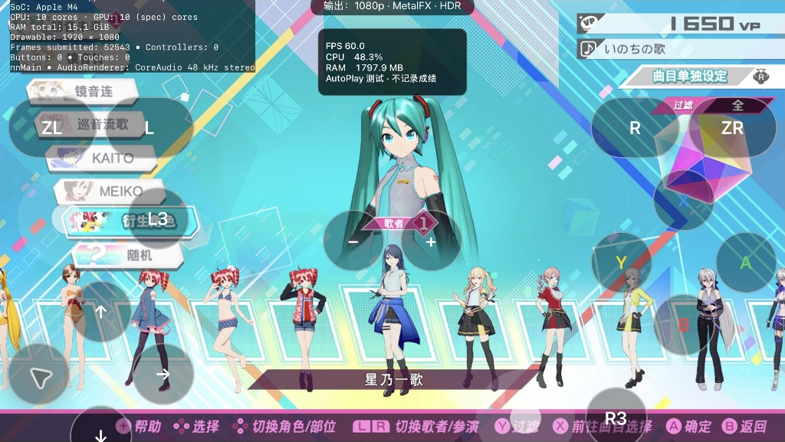

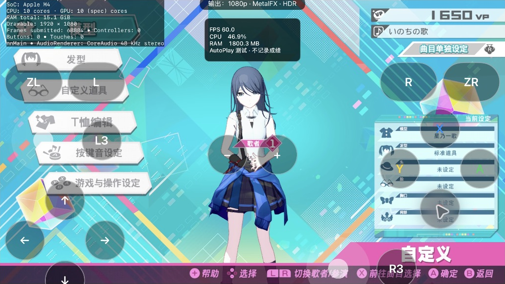

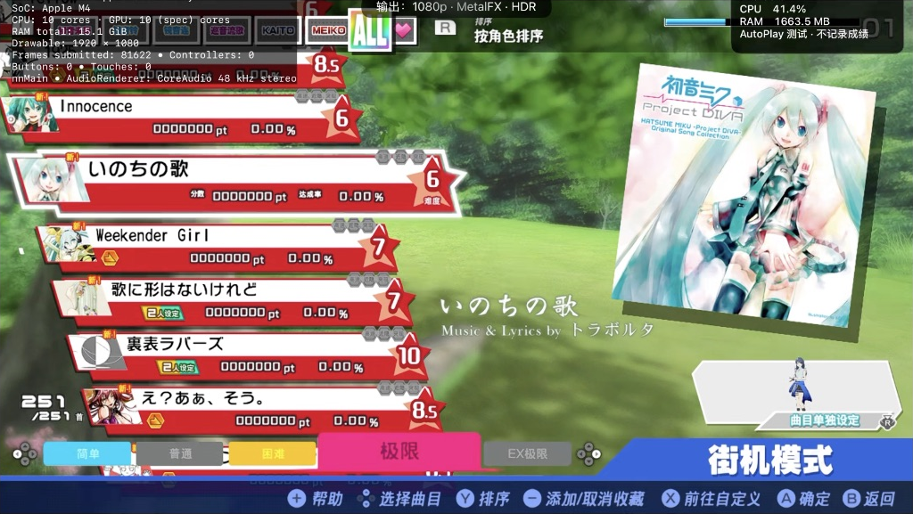

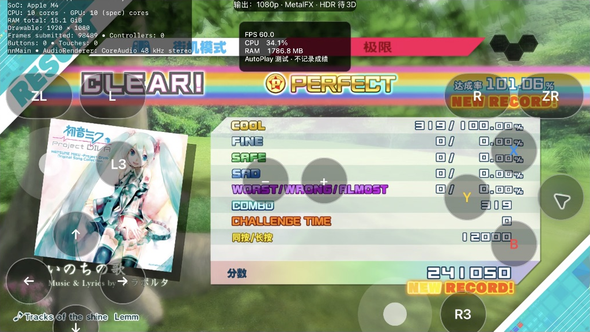

## 其他通过样本截图

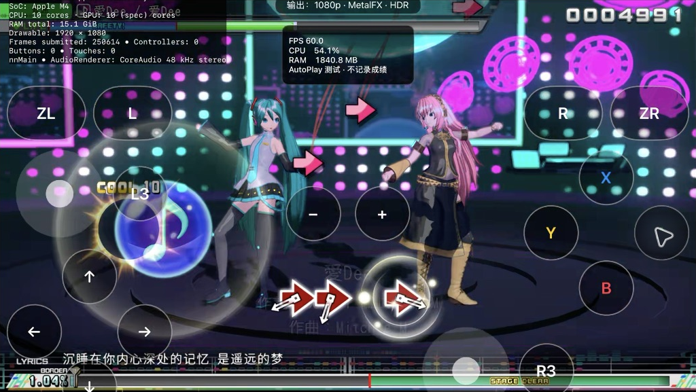

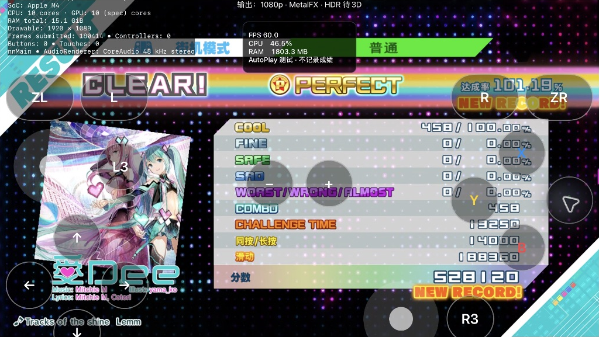

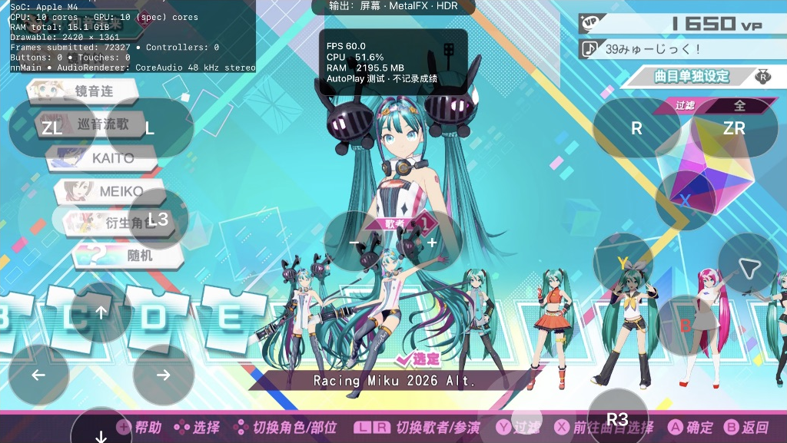

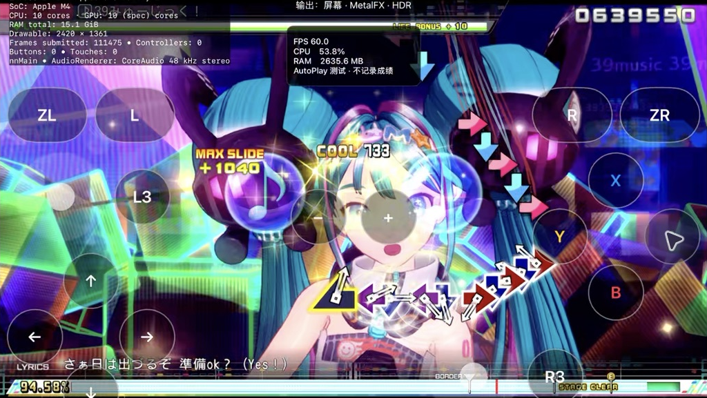

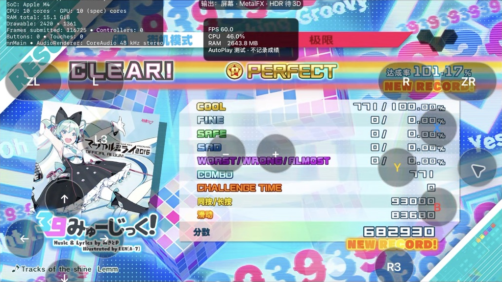

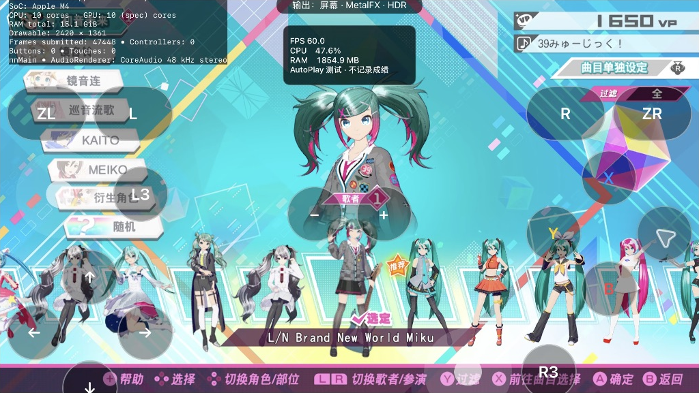

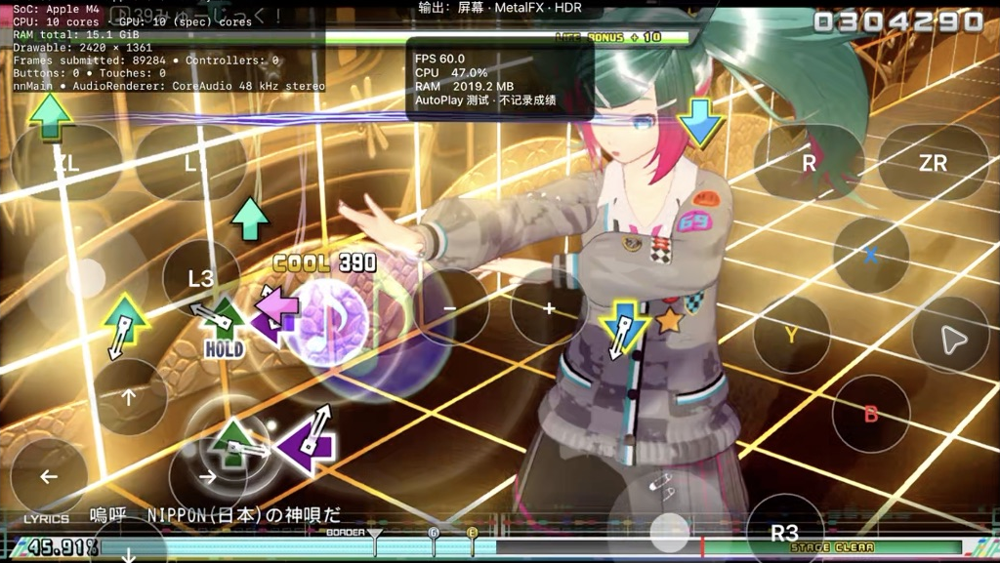

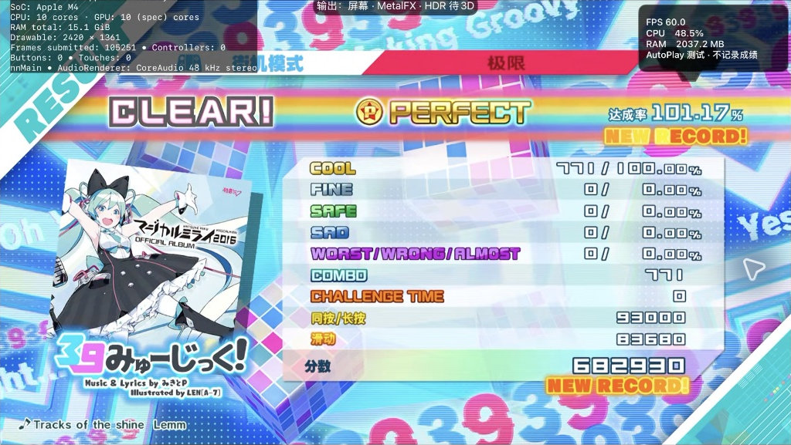

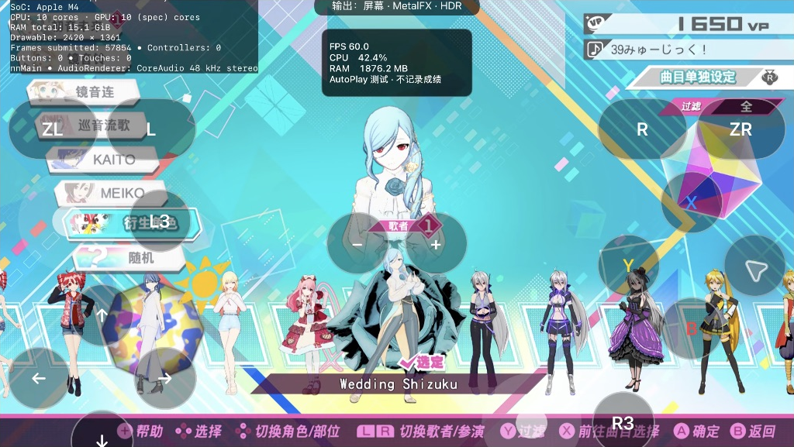

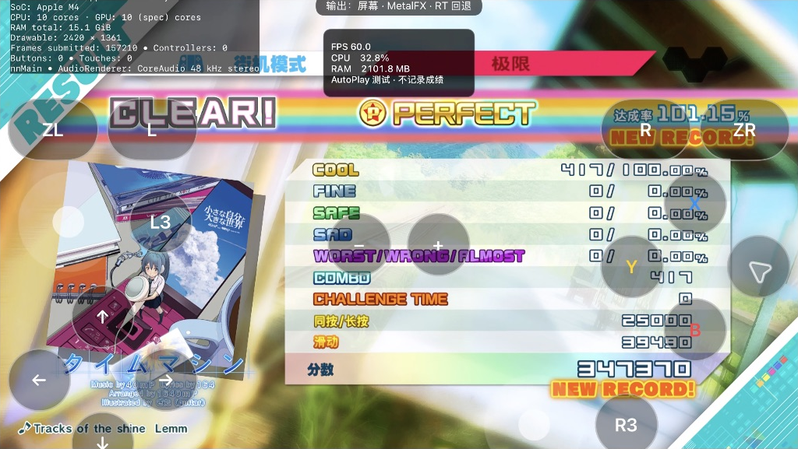

## F2nd Song 未通过的诊断

离线转换候选包含 39 个 PV 差量：替换 35 首原曲、增加 4 个登记项；生成 1378 个文件，1,092,662,095 B。舞台、对象、纹理、动作、精灵、AET 和缩略图表完成结构检查，传入 iPad 后逐文件完整 SHA-256 回读匹配。**结构与传输校验通过不等于运行通过。**

首次 SPiCa 启动在 Auth3D 读取中以空指针退出（`main+0x223de8`）。随后发现相机压缩包是部分条目替换，不能覆盖整个原包；生成独立修正层，合并原有动画条目、规范化分类文件名，并隔离源包中未提供的动画登记。修正层另传 96 个文件、56,846,024 B，并完整回读校验。复测仍在动画参数读取异常路径退出（`main+0x23214c`）；反汇编指向 `play_control.begin` 的缺失字段处理，具体触发条目还未定位。没有用跳过崩溃、删除场景或空动画冒充兼容。

包内还发现一些不存在的 TITLE 场景索引和未引用的 AET 登记。候选做了保守过滤，但未通过整曲，因此这些处理没有获得画面验收。下一步应定位实际载入的 Auth3D 条目、补齐源包所需的转换语义，再重新测试；目前不能交付为开箱即用的 F2nd 包。

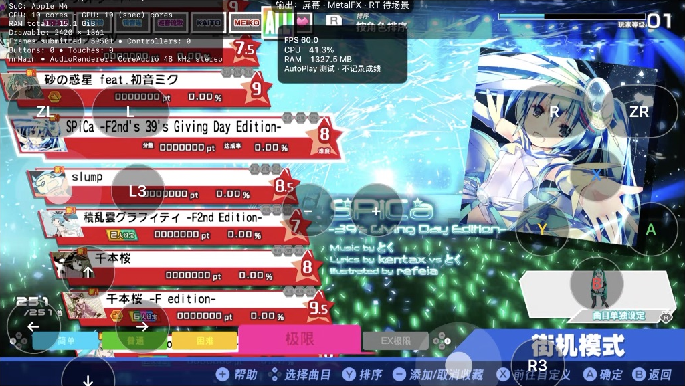

## 性能取样与边界

| 会话 | 计数前进样本数 | 显示 FPS 中位数／P10 | 样本内 App 内存峰值 MiB |
| --- | --- | --- | --- |
| LeoNeed | 231 | 60.00／60.00 | 1776.3 |
| Racing | 404 | 60.00／60.00 | 2663.7 |
| Sekai Miku | 403 | 60.00／60.00 | 2059.6 |
| Sekai Mini | 433 | 60.00／57.97 | 2245.9 |

统计来自 AutoPlay 命中计数前进时的显示提交采样。不是 GPU 帧时间、输入延迟或低配设备保证；Sekai Mini 会话包含部分播放与后续 Time Machine，且输出设置曾改变，不能作为受控的包间性能横评。原始运行日志含本机信息，仅本地保存；公开的是[去标识统计](images/mod-ipad-20261029/performance-sampling.json)。截图只裁出游戏画面，没有重绘。

转换和传输始终单包串行：媒体以 1 MiB 块复制，逐个 FARC 处理；既有离线读取器限制编码档 128 MiB、单条展开 256 MiB、单档累计 384 MiB。传输写入临时文件，完整回读后才改名启用。源 MOD、原 XCI 和原游戏资源均未改动。该流程仍在电脑端完成；App 内通用转换器、依赖图合并、多包冲突解决和 M1 内存验收未完成。

## English

This is a separate **physical M4 iPad** follow-up to the earlier simulator report. The installed local candidate is based on build19 and adds pre-launch selection of prepared runtime packages plus module-menu fixes. **There is no new installer release in this report, and the public build19 is not claimed to convert these packages automatically.** No MOD/game payloads, keys, saves or signing configuration are published.

Acceptance was deliberately limited to **one model and one complete song per package**, with one active package at a time. Hardware: 11-inch M4 iPad Pro, iPadOS 27.2, Apple GPU family 9, nominal 16 GB RAM; JP v1.0.9 plus 27 DLC assets. This does not qualify M1 or older operating systems.

Five packages completed their sampled songs: **X Song / Ai Dee NORMAL** (458 COOL, 101.19%, 528120); **LeoNeed / Ichika / Inochi no Uta EXTREME** (319 COOL, 101.06%, 241050); **Racing Miku 2026 Alt / 39Music EXTREME** and **L/N Brand New World Miku / 39Music EXTREME** (each 771 COOL, 101.17%, 682930); **Wedding Shizuku / Time Machine EXTREME** (417 COOL, 101.15%, 347370). Each maximum combo equals its COOL count. These are **experimental AutoPlay results, not real player records**. The normal save's two files retained their original SHA-256 hashes after all sampled runs and both F2nd failures. Temporary results are never merged back.

Ichika's wrong “white cat tail” name and missing bottom portrait were traced to the PC/Switch string-base difference, occupied module slots, the final DLC18 sprite/portrait lookup, and the exit-menu patch shadowing MOD strings. The candidate uses unused native module slots, merges both selection and item portraits into the actual DLC registry, and composes only the exit label into the selected language's MOD string table. Existing mesh, skin and texture data are retained. Other models in each pack are outside the reduced acceptance scope; visible thumbnails are not complete 3D verification.

**F2nd Song 1.03 failed SPiCa EXTREME.** The 39 PV delta conversion (35 replacements, 4 additions; 1378 files, 1,092,662,095 bytes) passed structural checks and full device readback hashes. Names and both covers appeared, but song startup crashed in Auth3D file reading. A separate 96-file / 56,846,024-byte layer merged partial animation archives with inherited entries, normalized category filenames and quarantined unavailable animation registrations. The retest progressed to another Auth3D parameter exception path; disassembly points to missing `play_control.begin` handling, but the exact offending entry remains unidentified. The failed package was removed from the selectable catalog while all diagnostic assets were retained. No crash bypass or empty scene is presented as a successful port.

**X Charts, F2nd Charts and F Charts stay disabled.** They require New Classics behavior; the first two additionally need their corresponding song packs. Copying DSC files alone does not implement their judgment, long-star or scoring changes. X Song's 32 registered tracks are not all-song acceptance, and Calc's earlier inverted shots remain unresolved.

The performance table above reports presentation FPS only when the AutoPlay hit count advanced, with memory peaks limited to those samples. It is not GPU timing or input latency. Sekai Mini includes an incomplete earlier play and a later complete Time Machine run, with changed output settings, so the sessions are not a controlled comparison. Screenshots are unaltered game-region crops; raw device-identifying logs remain local.

Conversion remains an offline, one-package-at-a-time process: 1 MiB media copying, bounded per-FARC decoding, temporary transfer files and complete SHA-256 readback before activation. Original MODs, XCI and base assets are preserved. A general in-App converter, dependency merging, multi-package conflict handling and lower-memory hardware qualification remain future work. The intended preconverted iOS MOD format must carry version/base fingerprints, verified payload inventories and dependencies before it can be offered as an out-of-box workflow.
