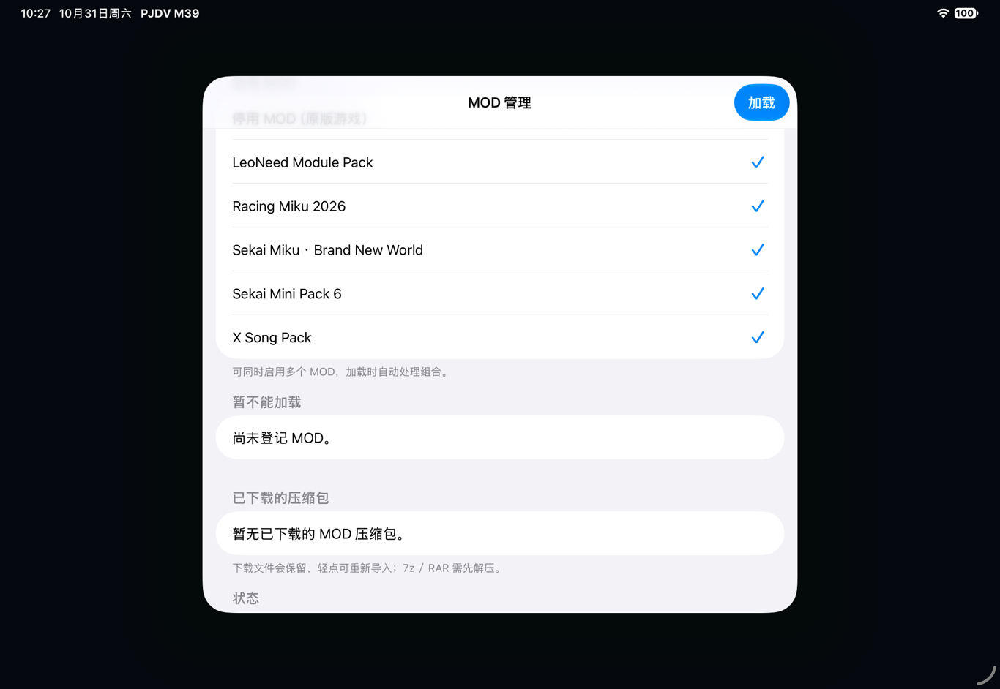
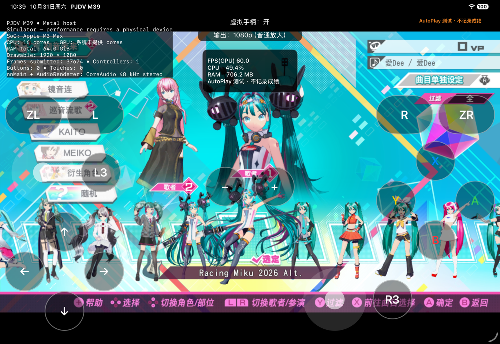
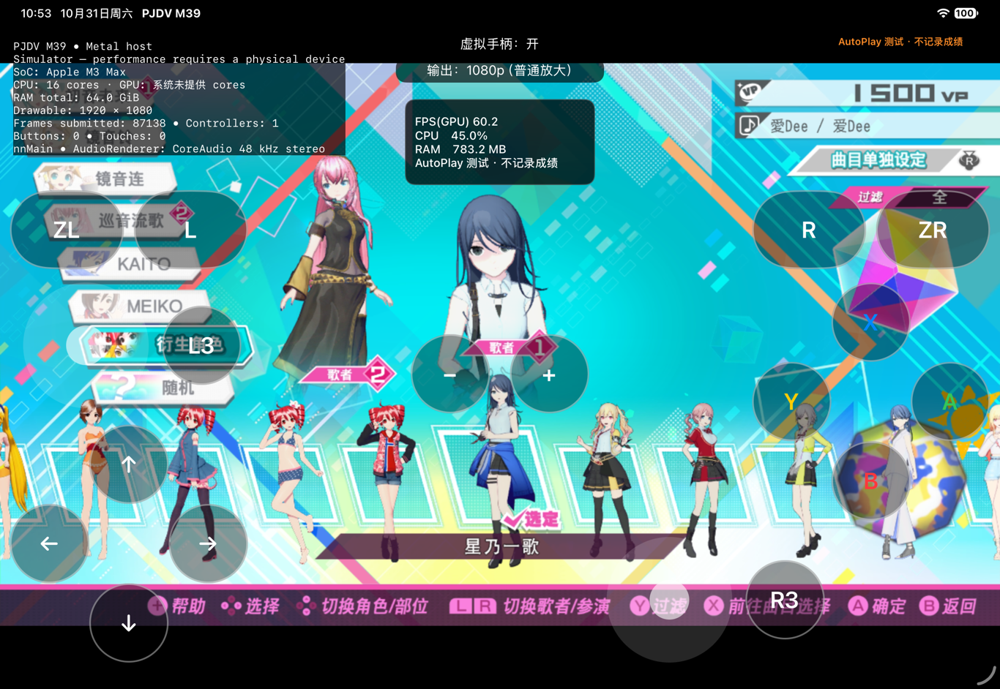
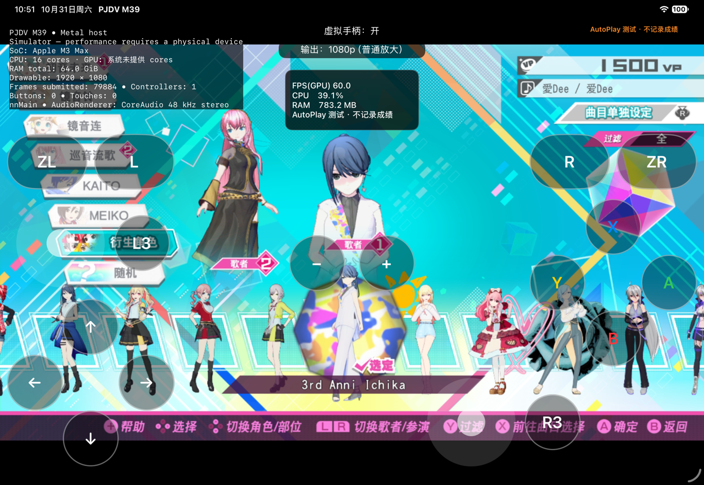
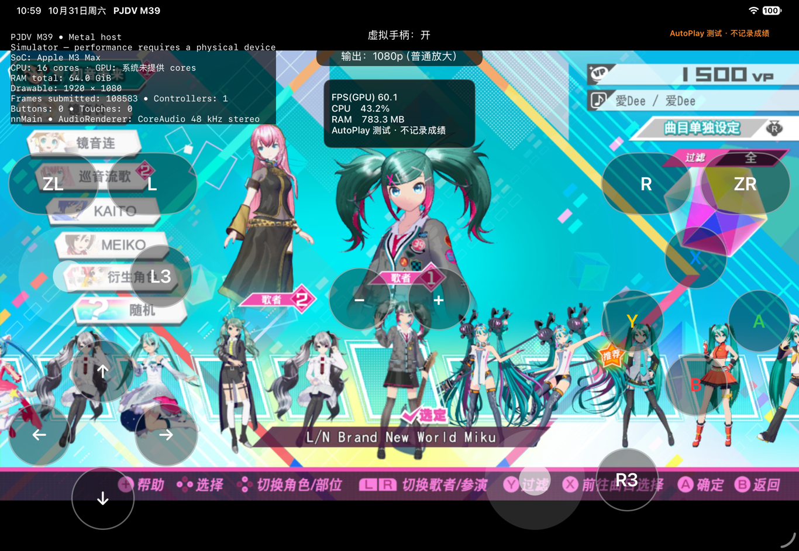
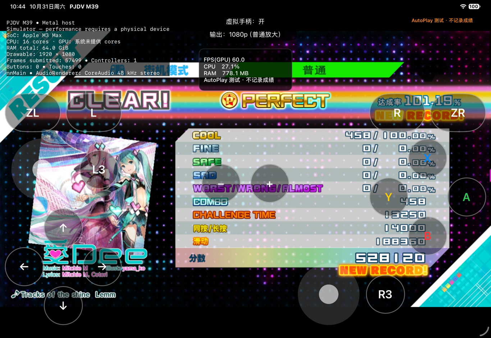
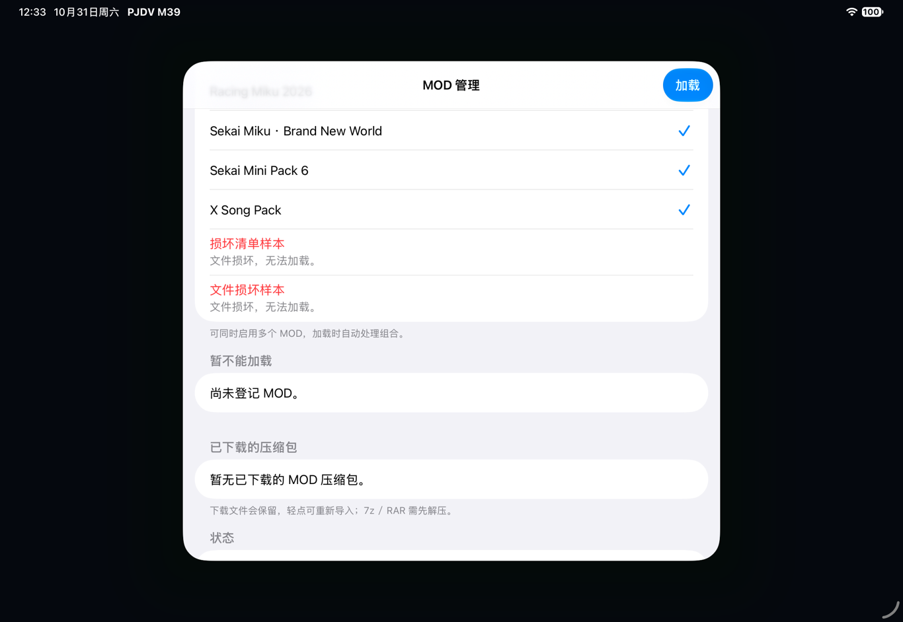

# App 内多包加载与恢复 / Native multi-MOD loading and recovery

2026-10-31。本地候选，公开安装包仍为 build19。本报告替代 10 月 30 日报告中“App 内多选合并尚未完成”的进度描述；不改变其历史测试结果。

## 玩家操作

导入已适配 ZIP／文件夹 → 勾选要用的包 → **加载** → 启动游戏。编号分配、数据库合并、缓存和存档目录由程序处理。管理器不显示开发者的歌曲抽测、帧率或验证报告。

加载成功才提交选择。失败、取消或直接关闭面板不替换上一套活动配置；原包、已有组合缓存和存档不被改写。“停用 MOD（原版游戏）”再加载用于恢复原版配置。

**范围仍为 `pjdv-runtime-mod-v1` 已转换资源包。原始 PC MOD 的通用原生转换器、清单 v2、New Classics 和任意包兼容承诺均未完成。**

## 已实现

- 独立多选，最多 16 个包；旧单选设置可迁移。
- 同一组包按稳定包 ID 排序处理，组合身份不随点击顺序变化。不同组合使用独立存档目录；AutoPlay 仍使用独立临时档。
- 对象、纹理、服装、模块、名称表、精灵及相关舞台引用在应用内合并。基于真实基础／地区／DLC 数据库取差量，不依赖外部预合并五包。
- 同名但不能证明内容一致的模型可独立改名并更新引用；无法完整处理的依赖或冲突会阻止加载，不采用整表最后覆盖。
- 精灵图集允许同名对应多个 ID，以及同一 ID／名称在不同图集使用不同局部索引；不同名称复用同一 ID 则拒绝。
- 转换报告与已经不在包内精灵数据库注册的旧 PC 服装预览残留不作为游戏覆盖文件参与组合。
- 大媒体优先硬链接，跨卷时以 1 MiB 分块复制；元数据解码有边界。修改对象编号时保留原贴图压缩块，不展开 Racing Miku 超过 150 MiB 的贴图。
- 临时目录完整生成后原子发布，取消或失败清理临时结果。缓存校验发现损坏会重建，既有可用组合保留。
- 逐包读取清单：损坏清单或不安全目录只隔离对应包，其他包继续显示。坏包标红，不能被新启用。
- “重新完整校验”分块检查全部载荷 SHA-256，包括启动快速检查只核对大小的超过 2 MiB 文件。已知坏文件在重新启动后仍不可加载，完整重检通过才解除标记。校验不更改载荷或存档。

组合身份目前基于包 ID 集合。**包升级后长期编号迁移、跨版本存档迁移、备份／恢复界面尚未验收**，不能将同一组合的顺序稳定性等同于这些能力。

## 本机模拟器验收

使用 iPad Pro 11 英寸（M5）模拟器、iPadOS 27.2，宿主 M3 Max／64 GiB。测试资源、组合输出、临时存档和构建放在外置 SSD；未使用真机，未修改原始 XCI。

| 项目 | 结果 |
| --- | --- |
| 五个独立包 | X Song、LeoNeed、Racing Miku 2026、Sekai Miku Brand New World、Sekai Mini Pack 6 同时勾选，经 App 的“加载”自行组合成功。 |
| 独立数据库检查 | Python 读取 Swift 输出：17 个新增服装、34 个预览绑定、五种语言名称、服装与对象引用及精灵 ID 一致；基础文件指纹未变。 |
| 角色抽样 | Racing Miku 2026 Alt.、星乃一歌、3rd Anni Ichika、L/N Brand New World Miku 的名称、预览和实际装备模型可见。不是全部服装／镜头验收。 |
| 新增歌曲 | 曲库显示 276 首；《愛Dee》NORMAL 完整结算，AutoPlay 458 COOL／458 连击。仅临时档产生游戏存档，原版档和正常组合档未写入该成绩。 |
| 组合失败 | 加入故意无效的字符串表样本，App 显示加载失败；回读活动选择仍为原五包，完整组合缓存保留。 |
| 坏包隔离 | 一个坏清单不清空其他包；同大小的 3 MiB 损坏载荷通过快速大小检查，但完整校验发现并标红。 |
| 重检恢复／纯净启动 | 修复合成样本后，App 完整重检清除其隔离标记；坏清单继续单独标红。移除仅用于测试的三个样本后，停用 MOD 并加载，原版片头正常输出。 |
| 自动检查 | AddressSanitizer 下格式边界、gzip CRC、精灵别名、取消、缓存损坏重建、冲突回滚、单选迁移、坏清单隔离及完整哈希恢复检查通过。 |

本机命令行抽样中，双模型组合生成约 2.9 秒，五包缓存读取约 2 秒；子进程峰值常驻内存约 457 MiB。这不是 8 GB M1 真机导入压力测试，也不是游戏长期内存或帧时间结论。模拟器显示约 60 FPS 不代表 iPad 持续性能。

## 截图

## 后续优先级与验收门槛

1. **清单 v2 与编号持久化**：包 ID／版本、游戏基线、转换器版本、依赖版本范围、玩法能力、组合成员与编号映射。保留 v1 读取；升级前备份，映射变更不能把旧成绩关联到另一首歌。不能只更改格式名称。
2. **玩家安装闭环**：先将已有成功的模型与 X Song 包型转换移入 App；未知格式明确拒绝。补升级、卸载、空间统计、安装中断恢复和存档备份。下一次发布门槛是玩家自行导入模型与歌曲，组合、游玩、正常保存、重启，再停用回到原版。
3. **New Classics 独立推进**：分别验证谱面解析、长按／连星／Rush、判定计分、Chance Time／Technical Zone、HUD 和结算。用固定输入与预期计分对照；原版 AutoPlay 全 COOL 不能证明新玩法正确。普通模型与歌曲包不强依赖它。
4. **兼容缺陷回归**：SPiCa 继续记录 Auth3D 资源名、属性、引用链和边界，缩小最小失败片段；恢复遗漏条目不等于崩溃已解决。Calc 按坐标系、相机和旋转曲线定位，不能全局翻转画面。
5. **认真游玩的验证**：原生 60 FPS 真人快速重按、滑键、多押、手柄热插拔、音画偏移，以及连续切歌换装、暂停恢复与长时间帧时间；补脱敏诊断导出和统一社区步骤。诊断不含密钥、资源、存档或个人路径。

HDR、光追与插帧新增研究排在上述工作之后。F2nd《SPiCa》仍未解决；三个 Charts 包仍需 New Classics；本轮未改变 Calc 倒置问题，也没有将这些包伪报为可玩。

## English

This October 31 local candidate adds **native multi-selection and composition of already converted v1 resource packages**. The public installer is still build19. Select independent packages and tap **Load**; the App handles registry deltas, IDs, references, caching and combination-specific save directories. Developer test reports and frame-rate results are not part of the MOD manager.

Selections are committed only after loading succeeds. A failed/cancelled draft or dismissed panel leaves the previous active configuration intact. Build output is staged and published atomically; a failed build does not overwrite original packages, existing working combinations or saves. Selecting the original-game option restores the vanilla configuration. AutoPlay uses a separate disposable save snapshot.

The native merger handles object/texture/costume/module registries, localized labels, sprite atlases and relevant stage references against actual base/regional/DLC data. It namespaces different same-name models when all supported references can be updated, and rejects unresolved cases. Sprite names may alias multiple IDs; local atlas indices are preserved. Converter reports and unregistered leftover PC portrait archives are excluded. Bulk assets are linked or copied in 1 MiB chunks. Object edits preserve large compressed texture entries instead of inflating them.

Malformed manifests are isolated per package rather than blanking the entire list. **Verify all files again** streams every payload through SHA-256, including media larger than the fast-launch 2 MiB hashing threshold. Known damaged payloads stay unavailable until a successful full recheck. Verification changes only the App's availability marker, never package payloads or saves.

On the local M5 iPad Simulator (iPadOS 27.2, M3 Max/64 GiB host), the UI selected and loaded X Song plus all four independent model packages without an offline combined package. Independent Python readers verified 17 added module entries, 34 portrait bindings, labels in five languages, costumes/object references and consistent sprite IDs. Original baseline hashes were unchanged. One equipped model from each of the four packages was visible. The library contained 276 songs; Ai Dee NORMAL completed with **458 COOL / 458 combo** in AutoPlay. Only disposable test saves received the score; this does not validate long-term normal-play save migration.

A deliberately invalid string table failed loading while the active five-package selection and complete cache remained unchanged. A malformed manifest did not hide healthy packages. Full verification identified same-size corruption in a 3 MiB synthetic payload and marked it unavailable. After the synthetic payload was repaired, another in-App full check cleared its marker while the malformed manifest remained separately unavailable. The three synthetic fixtures were then removed; disabling MODs and loading the vanilla configuration produced the original opening normally. AddressSanitizer checks passed for format bounds, gzip CRC, sprite aliases, selection migration, cache rebuild, cancellation/rollback, isolated malformed manifests and full-hash recovery.

Local command-line samples took about 2.9 seconds for a two-model build and 2 seconds for the five-package cache; peak child-process resident memory was about 457 MiB. These are not measurements on an 8 GB M1 or sustained physical-device gameplay benchmarks. All new test data/build output stayed on external SSD; no original XCI was changed.

**Still pending:** manifest v2 and persistent upgrade mappings; dependency/capability/version checks; native conversion of raw PC packages; upgrade/uninstall/space controls; normal-save migration and backup/restore. The present identity is derived from the unordered package-ID set: stable click order does not establish safe migration after package updates. Arbitrary MOD compatibility is not promised.

Priority is the player installation/recovery workflow before more HDR/RT/frame-generation work. Manifest v2 must describe package/version, game baseline, converter version, dependency ranges, gameplay capabilities, combination members and persisted ID maps. Next release acceptance requires a player to import a model and song package, combine/play/save/relaunch, then disable MODs and return to vanilla. New Classics needs separate staged parsing/scoring/HUD acceptance with fixed inputs and expected scores, not original AutoPlay as a substitute. SPiCa remains an Auth3D crash investigation; Calc's inverted camera remains unresolved. Real touch/controller timing, frame pacing, long sessions and privacy-filtered diagnostics also remain separate acceptance work.
