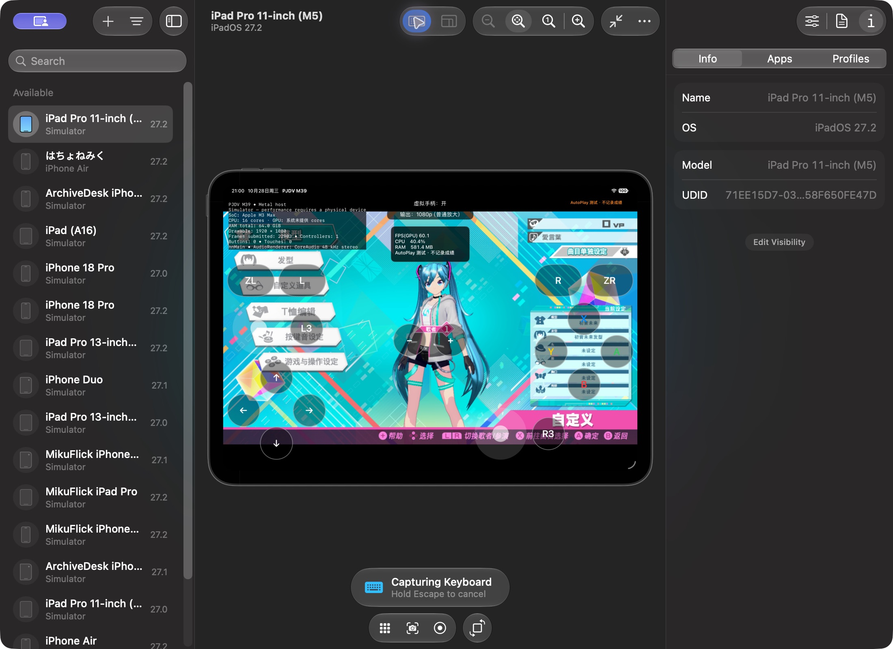
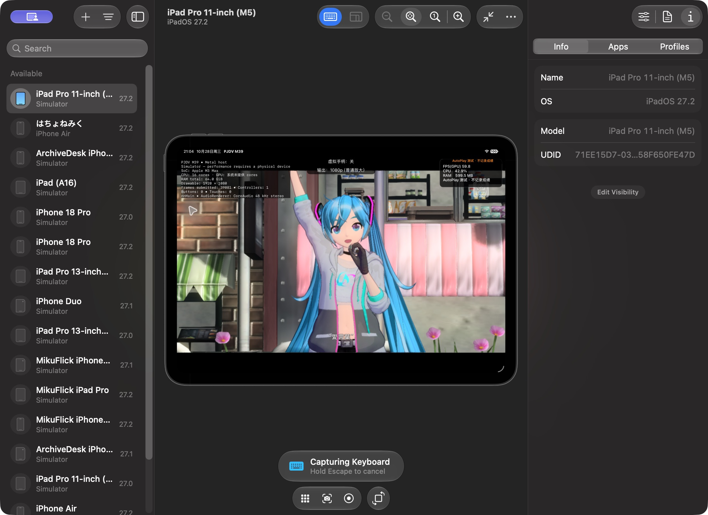

# Rage Winter 2020 Miku — 单包模拟器验证 / Single-package simulator trial

2026-10-28（2026-10-29 公开报告与截图，不含 MOD 资源）。**已在模拟器实际显示模型并完成《愛言葉》实时 PV；仍是独立试验配置。**

## 本轮范围

只加载 `Rage Winter 2020 Miku` 一个 PC 模型包。没有启用 `(2)` 副本、其他曲包、服装包或任何 PC DLL。

为先验证资源兼容，试验配置暂时替换初音 costume 0：默认服装仍显示原来的名称和图标，但身体、手、头发、眼部贴图来自 MOD。**这不是新增 module 6065 的正式菜单登记，也不是通用 MOD 导入功能。**原游戏目录未替换；关闭该试验覆盖层即可恢复原服装。

## 转换与适配

- 读取 PC 的对象／贴图数据库、chritm 部件表、模型、skin 参数和 osage 登记。
- 检查本体、内置 DLC 表和外部 DLC 的已用 ID。PC 对象集编号重新分配为 3817–3820；82 个贴图编号重新分配为 67313–67394，避免接近一千万的稀疏贴图 ID。
- 物品编号 6065／6365／6565／6865 映射为试验表中未占用的 154／157／159／161；costume 0 引用这四个部件。
- 同步修改对象集贴图列表和材质槽中的 ID，保留其他模型字节。未改变网格、法线／切线、颜色、蒙皮和贴图数据。
- 合并原对象／贴图数据库，并保留原记录；FARC 重新打包后逐条解包核对。
- 本体和内置 DLC 各有一份初音 costume 0 登记，因此两层 chritm 表都做了会话局部适配，避免 DLC 再次覆盖为原服装。
- 将 model-specific skin 参数加入只读试验覆盖层，合并 osage 登记。没有把 PC 插件注入 Apple 程序。

## 实际运行验证

环境：iPad Pro 11-inch（M5）模拟器，iPadOS 27.2；实际宿主为 M3 Max、16 核 CPU／40 核 GPU／64 GiB RAM。输出 1920×1080，普通放大，原生 60 档。

1. 游戏正常启动并进入曲目选择。
2. 自定义界面显示灰色外套、短裤、手套、腿带及长发；文件读取日志确认四个 MOD 模型 FARC 与两个 skin 参数文件实际被游戏读取。
3. 以该模型播放《愛言葉》实时 PV。抽查了舞蹈、张口、面部与眼部、发丝随动作变化、衣服和手部；未观察到角色消失或明显网格爆炸。
4. PV 完整播放到“重开／返回曲目选择”画面，正常返回选曲。
5. 再次进入自定义，MOD 模型仍可重新载入。

预烘焙的 `osage_play_data` 缓存文件未在本次读取日志中出现；已观察到的是 skin 参数读取和动态画面表现。不能据此宣称所有发丝／碰撞／预烘焙物理路径均已通过。

## 性能与日志

PV 中 source frame 30000–39000 的 300 个监测样本：

| 指标 | 本次结果 |
| --- | ---: |
| 监测 FPS 中位数 | 60.00 |
| 帧间隔 p50 / p95 | 16.75 / 19.48 ms |
| CPU 占用中位数 | 44.82%（单核满载为 100%） |
| 样本内 RAM 峰值 | 599.47 MiB |

这些是 Mac 上模拟器的局部监测结果，不是 M5、M4 或 M1 真机成绩，也没有做同镜头原模型 A/B 性能对照。没有进行长时间泄漏测试。

未检出 GPU command-buffer 错误或进程崩溃记录。启动日志保留一条既有的 `c1_full.tsv` 过期／缺失保守回落提示；不加载 MOD 的旧基线也有该提示，不能将本轮描述为“日志零警告”。

## 数据保护与产物

- AutoPlay 测试会话启用独立存档，不合回正式成绩。
- 正式 `GuestSave` 前后均为空，校验一致。
- 此前保存的 18 个 PC MOD 原资源哈希仍一致，原游戏数据库哈希仍一致。
- 公开内容仅为报告、工具和截图，不包含安装包、XCI、prod.keys 或 MOD 资源。

试验目录：`/Volumes/Switch-iOS-Dev/Build/ModLoad-RageWinter-20261028`

- `build_trial.py`：当前单包适配脚本，只写本目录的 `overlay/`。
- `manifest.json`：ID 映射、输入数据库指纹、输出文件及模型字节修改记录。
- `VERIFICATION.json`：运行证据、性能样本和保护检查。
- `fs.tsv`、`loaded-mod-files.json`：游戏实际读取资源的记录。
- `PJDV-runtime.log`、`PJDV-benchmark.jsonl`：本轮运行副本。
- `customization.png`、`pv-mid.png`、`pv-late.png`、`pv-completed.png`、`returned-song-menu.png`：画面证据。

试验利用已有的 `DM_ROMFS_OVERLAY`，没有开放 build18 中仍禁用的通用 MOD provider。启用资源覆盖层必须在进程启动前设置；不要在会话中改目录或数据库。

## 后续边界

下一阶段应把这套服装新增到独立菜单槽位，处理名字、缩略图、发型登记和保存隔离，再验证不同歌曲、其他服装切换和真机性能。本轮仅确认一个模型包在上述场景能够实际载入与渲染。

---

## English

**One package was loaded and visually verified in the simulator: Rage Winter 2020 Miku.** Its duplicate and all other MODs remained inactive. No supplied PC executable was run.

This private trial replaces Miku costume 0 through an isolated, read-only RomFS overlay. It is not additive module 6065 registration, a general MOD importer or a public release. The original game resources retain their bytes, names and menu records outside this test profile.

Four object sets were remapped to IDs 3817–3820. Eighty-two texture IDs were remapped to 67313–67394 after checking existing base/DLC records. Material references and object-set texture lists were updated consistently; other model bytes and all texture payloads were preserved. The original databases were merged rather than discarded, and repacked archive entries were verified after decoding. Both base and built-in DLC costume tables required local adaptation.

The modified outfit appeared in customization and in the real-time Ai Kotoba PV. All four model archives and both skin parameter files were observed in guest reads. The PV played to its completion menu, returned to song selection and allowed the model preview to load again. Selected shots showed the outfit, face, eyes, mouth, gloves and long hair without observed missing geometry or mesh explosions. This is not exhaustive animation/physics acceptance. Prebaked osage cache reads were not observed.

The test used an M5 iPad simulator running on an M3 Max Mac, not physical M5 hardware. At 1920×1080, 300 steady PV samples showed a median 60.00 FPS, frame-interval p50/p95 of 16.75/19.48 ms, median CPU 44.82% and sample peak RAM 599.47 MiB. There was no matched baseline comparison or long-run leak test. A pre-existing conservative c1 manifest fallback warning remains; no GPU command-buffer error or process crash was found in the session log.

Normal save hashes, original PC MOD resource hashes and original database hashes remained unchanged. The session uses AutoPlay's disposable save profile. Evidence, the reproducible trial adapter and generated overlay are stored in the external SSD directory above. The October 29 publication contains this report, tools and screenshots only; no installer or MOD assets are included.

The generic MOD provider remains disabled; this experiment uses the pre-existing fixed overlay mechanism. Additive menu registration, localized names, thumbnails, other songs and real-device performance remain separate follow-up work.
