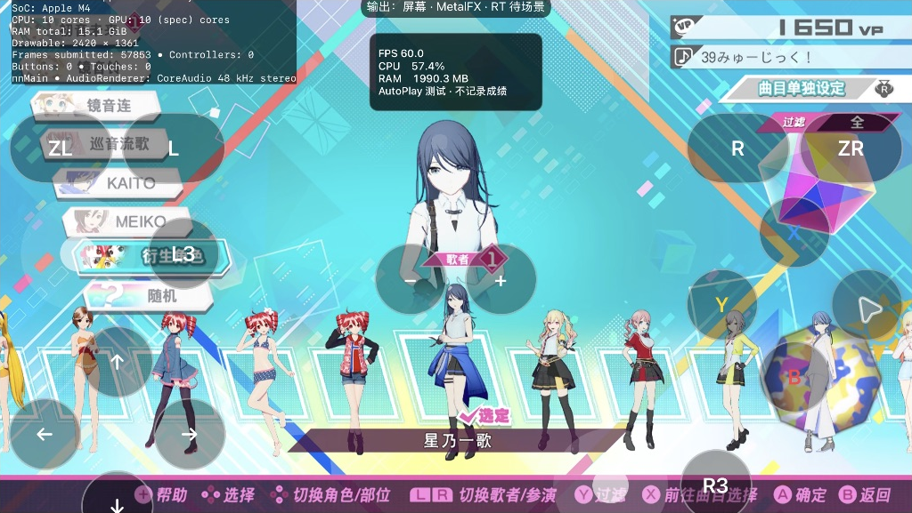
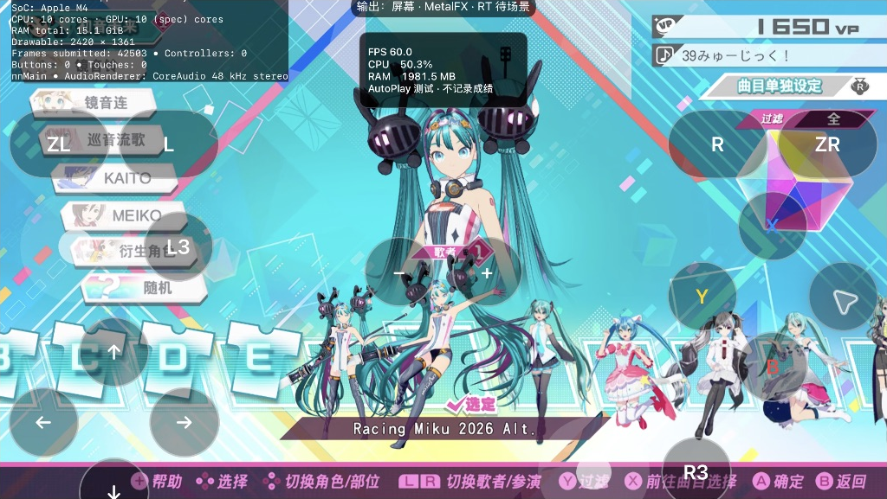
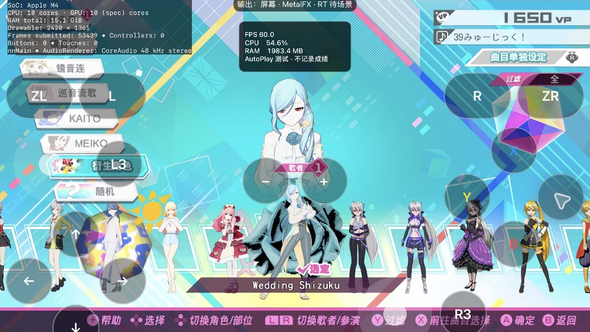
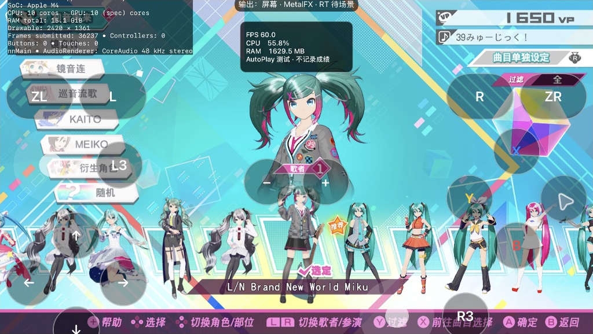
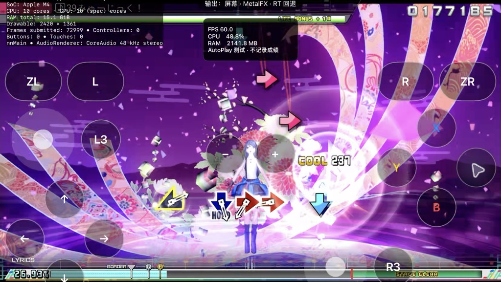
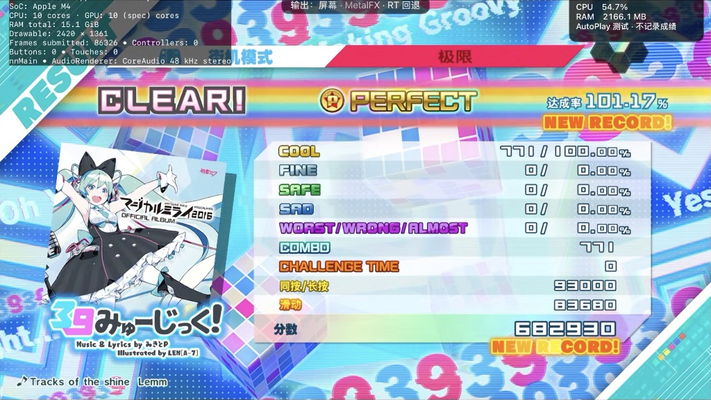

# 五包联合验证与剩余阻碍 / Five-package trial and remaining blockers

2026-10-29 至 2026-10-30；本地研究候选，尚未发布新安装包。本次“全部”指用户指定的九包，不包含 PC mods 目录内其他包。

## 联合运行结果

M4 iPad Pro 11 英寸、iPadOS 27.2、基础游戏 1.0.9＋27 DLC。一个组合同时包含 **X Song Pack、LeoNeed Module Pack、Racing Miku 2026、Sekai Mini Pack 6、Sekai Miku Brand New World**，共 17 个服装条目、1,144 个文件、3,396,703,592 字节。传输后所有文件完整 SHA-256 回读一致。

| 同一组合内的抽样 | 实际检查结果 |
| --- | --- |
| LeoNeed：星乃一歌 | 名称、底部缩略图、装备后的 3D 模型正常。 |
| Racing Miku 2026 Alt | 名称、底部缩略图、装备后的 3D 模型正常。 |
| Sekai Mini：Wedding Shizuku | 名称、底部缩略图、装备后的 3D 模型正常。 |
| Sekai Miku：L/N Brand New World | 名称、底部缩略图、装备后的 3D 模型正常。 |
| 星乃一歌＋《39みゅーじっく！》EXTREME | 完整结算：771 COOL／771 连击，101.17%，682,930 分。AutoPlay 使用临时隔离存档；两个普通存档文件的 SHA-256 未变化。 |

本轮联合整曲采用原版《39みゅーじっく！》，不等于五包组合中的全部 X Song 曲目已验收。X Song 的媒体与注册内容已合入；《愛Dee》此前在 X Song＋LeoNeed 双包组合完成整曲，见[双包报告](COMBINED-MOD-TRIAL-20261029.md)。其他模型与曲目仍按抽样范围理解。

AutoPlay 命中计数推进期间采到 404 条显示采样，显示 FPS 中位数约 60.0，P10 约 60.0，App 内存峰值约 2,192.5 MiB。输出为 2420×1361 MetalFX，日志指示 RT 回退。这是显示节拍抽样，**不代表 GPU 全程帧时间、真人输入延迟、所有曲目稳定 60 或 M1 性能结论**；也不能直接与此前不同条件下约 42 FPS 的抽样推导优化幅度。[结构化记录](images/mod-all-20261029/validation.json)

## 组合阶段发现的问题

- 各包独立转换后的对象、纹理、服装、模块和精灵编号不能直接叠加，已为本候选统一分配并修改引用。
- LeoNeed 与 Sekai Mini 共用部分脸部内容。只有名称与实际贴图／模型内容都一致时才共用；转换后的压缩二进制不同，不直接视为资源冲突。
- 基础服装表在不同地区确有合法差异。差量比较接受实际存在的各基线版本，避免把原版条目误当成 MOD 新增。
- 补齐各地区及 DLC18 实际读取的头像数据库。快速换装后短暂空白会随后加载出缩略图，本轮没有将该等待误记为永久缺失。

以上合并仍由电脑端研究脚本制作；用户在 App 内任意勾选并自动合并，尚未实现。最终用户流程与冲突规则见[无需 Xcode 的工作流](MOD-APP-WORKFLOW-20261029.md)。

## F2nd Song：仍未通过

《SPiCa》EXTREME 仍在载入阶段终止，Guest 栈保持 `main+0x23214c` 的 Auth3D 属性读取异常。两类候选都实机复测失败：

1. 将 A3DC 曲线完整展开为文本 A3DA，保留动画键值与未知属性。
2. 在此基础上补齐公共 `rom`、地区和 DLC 中未替换的 FARC 条目。旧扫描漏掉公共 `rom`：`CAMPV079.farc` 原有 117 条，旧候选仅保留源包替换的 2 条。最新候选补入 2,276 个继承条目，仍未解除崩溃。

因此，公共目录遗漏是确定的转换缺陷，**尚无证据表明它是本次崩溃的完整原因**。A3DC 转换工具的合成曲线测试通过，也不等于 F2nd 游戏运行验收通过。未跳过异常、删除所需动画或用空场景伪装成功。普通存档校验未变；失败候选保留供诊断，并从可选列表隔离。

## 三个 Charts 包：玩法依赖未完成

X Charts Pack、F Charts Pack、F2nd Charts Pack 需要 New Classics 的判定、谱面和 HUD 适配，当前不按原版解析器强行启用。依赖研究见 [New Classics 报告](NEW-CLASSICS-FOUNDATION-20261029.md)。目前不能宣称九包全部运行成功。Calc 的部分镜头倒置仍是独立待修问题。

## 真实抓帧

以下仅裁切游戏区域，未重绘。

## English

This local M4/iPadOS 27.2 candidate combines **X Song, LeoNeed, Racing Miku 2026, Sekai Mini Pack 6 and Sekai Miku Brand New World**: 17 module entries and 1,144 files (3,396,703,592 bytes), all verified by full SHA-256 readback after transfer. Ichika, Racing Alt, Wedding Shizuku and L/N Miku each showed the correct name, portrait and equipped 3D model in the same combination.

Ichika completed **39Music EXTREME: 771 COOL / 771 combo, 101.17%, 682,930 points**. AutoPlay used an isolated temporary save, and both normal save hashes remained unchanged. This is an original song; it does not qualify all X Song tracks in the five-package combination. Ai Dee previously completed in the separate X Song + LeoNeed trial.

During advancing AutoPlay hits, 404 presentation samples had a median and P10 near 60 FPS, with peak App memory around 2,192.5 MiB at 2420×1361 MetalFX output. RT fallback was reported. These samples do not qualify GPU frame time, real-input latency, every song or M1 performance, nor establish a controlled improvement over the earlier 42 FPS trial.

This prepared combination remaps shared object/texture/costume/module/sprite IDs, merges actual regional/DLC databases and deduplicates verified identical shared assets. It is still assembled offline. **General in-App raw-PC conversion and arbitrary multi-selection are not implemented.** The [App workflow document](MOD-APP-WORKFLOW-20261029.md) separates the implemented importer from that target.

**F2nd Song remains failing.** SPiCa EXTREME still terminates during Auth3D loading at `main+0x23214c`. Fully expanding binary A3DC curves did not fix it. A second candidate restored 2,276 inherited archive entries missed under the common `rom` directory (CAMPV079 now has all 117 entries rather than two), but the physical retest still failed. That archive omission is a confirmed conversion defect, not a proven complete crash explanation. Synthetic converter tests are not runtime acceptance. The failed package is preserved outside the selectable catalog; normal saves stayed unchanged.

X Charts, F Charts and F2nd Charts remain blocked on New Classics gameplay integration. Nine-package success is not claimed. Calc's inverted shots also remain unresolved. Only source, reports and cropped screenshots are published; no game/MOD payloads, keys, saves or local signing material are included.
