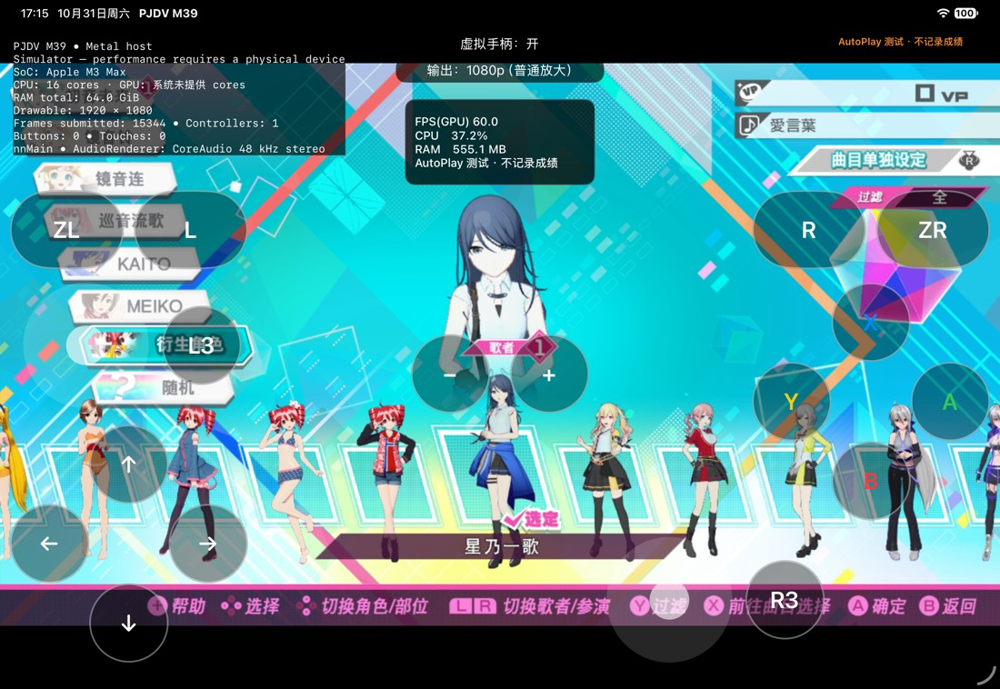
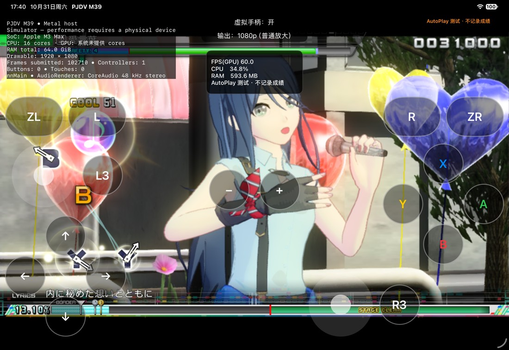

# 原始 PC 模型包的 App 内转换 / Native PC model import

2026-10-31 · 本地源码候选。公开安装包仍为 build19，本轮未发布新安装包或制作全量包。

## 玩家流程与支持范围

在资源首页打开 MOD 管理，添加原始 **Leo/need Module Pack 1.0.2** 的 ZIP 或已解压文件夹。App 识别、转换并登记后，勾选它再点击“加载”，进入游戏选择服装。转换发生在 App 内，不需要玩家运行 Python、Xcode 或 DLL；不会自动勾选刚导入的包。7z／RAR 仍需先解压。

目前仅接受这一个已验证版本的 42 个载荷文件，逐个匹配路径、大小和 SHA-256；单层外包目录也支持。内置配置只有路径／哈希，不含 MOD 内容。其他模型版本、原始歌曲包及 Windows 插件不能据此宣称兼容；未知内容保持不可加载，已适配包的原有导入流程保留。

## 已修改

- 新增原生模型转换器，重分配模型、纹理、服装部件及菜单编号，修正引用和各语言名称，登记角色预览和物理资源。压缩纹理块保留原始字节，不靠重绘或调色补偿格式问题。
- 首轮实际装备检查发现 DLC 精灵数据库覆盖了基础库，导致角色名字正确而底部头像为空。修复为同步更新实际 DLC 命名空间中的精灵登记和配套图档，并加入独立检查样本。最终候选四个头像均显示，星乃一歌名称和实际模型正确。
- 转换结果使用 `pjdv-runtime-model-v1`，携带转换器版本、源内容指纹、用到的基础／DLC 元数据检查值和 DLC 目录集合。旧 `pjdv-runtime-mod-v1` 继续兼容；旧客户端会拒绝新格式。**这不是完整的通用清单 v2，也未完成依赖求解或存档升级迁移。**
- 相同内容、转换器和资源基线复用完整校验通过的结果。转换在临时目录串行进行，清单最后发布；失败／取消清理本次临时结果，保留既有包和选择。不会修改原 ZIP、来源目录或游戏资源。
- 哈希和复制按 1 MiB 分块；元数据读取及档案解码沿用有界格式读取器。只在导入阶段转换，普通启动不会重新转换模型。

基线检查覆盖本次转换实际使用的 22 个基础元数据文件、1 个 DLC 精灵数据库和 27 个 DLC 目录。**它不是整个游戏／全部 DLC 载荷的完整哈希**。基线变化后停止加载，需重新导入；不把旧编号结果无条件应用到另一套资源。

## 验证与测量

环境：Apple M3 Max、64 GiB、外置 SSD，iPad Pro 11-inch M5 模拟器／iPadOS 27.2。游戏使用隔离 AutoPlay 临时档，不记录真实成绩。本轮没有连接 M1／M4 真机；模拟器帧率不代表这些设备的性能。

| 检查 | 最终候选结果 |
| --- | --- |
| 原始 ZIP → App 转换 → 选择 → 实际装备 | 星乃一歌中文名、四个底部预览及实际 3D 模型显示 |
| 歌曲抽样 | 《愛言葉》NORMAL 使用星乃一歌完整结算，PERFECT／100.71%，仅 AutoPlay 临时档；不代表四个角色全镜头验收 |
| App 与独立原生调用输出 | 同一 ID，92 个载荷的路径、大小及 SHA-256 一致 |
| App 重复导入 | 复用同一包，93 个文件（含清单）内容、大小与修改时间不变，来源 ZIP 和当前选择保留，无遗留提取副本 |
| 独立检查 | 模型／纹理／服装引用、名称、MD／THMB 预览配对；16 个原压缩纹理块保留 |
| 合成测试 | 重复复用、取消、源变更、未知 DLL、资源符号链接、DLC 元数据／目录变更、严格翻译解析、失败清理及来源保留通过 |
| 停用 MOD | 从管理器选择原版并加载，启动后正常进入原版主菜单；本次仅验证此隔离会话 |
| 既有检查 | RuntimeMods、ModComposition 检查通过；最终模拟器及 Mac Catalyst Release 构建通过 |

最终转换器 `native-pc-model-2` 的一次暖缓存原生调用：识别 **0.079 秒**，新转换 **2.375 秒**，再次复用并完整校验 **0.242 秒**，进程峰值常驻内存 **195.8 MiB**。这是同一主机的一次转换阶段测量，**不含 ZIP 导入全程，不是歌曲载入时间，也不是 M1／iPad 的内存或性能保证**。结果缓存能省去重复转换，不能据此推算整曲载入提速。

## English

This is a source/local candidate dated October 31, 2026. The public installer remains build19; no new installer or full game bundle was produced.

From the resource launcher, import the raw **Leo/need Module Pack 1.0.2** ZIP or extracted folder, wait for conversion, select it, and tap Load. The App performs conversion without Python, Xcode or DLL execution on the player's machine. Import does not activate a package automatically. Extract 7z/RAR first. Recognition matches all 42 payload paths, sizes and SHA-256 hashes; one wrapper directory is supported. Bundled profiles contain hashes only. Other raw models/versions, songs and Windows plugins remain unsupported unless separately adapted. Existing prepared packages retain their import path.

The native worker remaps object, texture, item/costume and module references, localized names, preview registries and physics resources. Compressed texture blocks retain their original bytes. Actual equipment testing exposed a DLC sprite-database override: names worked but bottom portraits were absent. The final revision updates the DLC registry and its paired image archives, with a synthetic regression case; all four portraits now display and Ichika's name/equipped 3D model are correct.

The distinct `pjdv-runtime-model-v1` format records converter revision, source fingerprint, used base/DLC metadata and DLC folder topology. Legacy packages remain supported; older clients reject the new format. This is **not** the complete general manifest v2, dependency resolver or save-upgrade migration. Checks cover 22 base metadata files, one DLC sprite database and 27 DLC directories, **not every game/DLC payload byte**. A changed baseline stops loading and requires re-import.

Identical content/converter/baseline reuses a fully verified result. Work is serialized in staging, with the manifest committed last. Cancellation/failure removes this attempt's temporary output while retaining existing packages and selection. Original ZIP/folder/game resources stay unchanged. Hashing/copying uses 1 MiB blocks; bounded archive/metadata readers remain in use. Normal launch does not reconvert models.

Tests used an M3 Max/64 GiB host, external SSD and M5 iPad Simulator/iPadOS 27.2 with a disposable AutoPlay save. Ichika was equipped and completed Ai Kotoba NORMAL: PERFECT / 100.71%, in the disposable AutoPlay save. Actual App re-import reused one package: all 93 files including its manifest retained contents, sizes and timestamps; the source ZIP/selection remained, without an extraction copy. Four preview images were checked, **not four complete model/PV validations**. The App and independent native invocation produced the same ID and all 92 payload hashes/sizes/paths. Reference/preview checks and 16 unchanged compressed texture blocks were verified. Synthetic cancellation, source mutation, unknown DLL, asset symlink, changed DLC metadata/folders, cache, strict translation and cleanup cases passed, as did existing RuntimeMods/ModComposition suites and final Simulator/Mac Catalyst Release builds.

One warm-host final `native-pc-model-2` run measured **0.079 s recognition, 2.375 s conversion, 0.242 s fully checked reuse, 195.8 MiB peak RSS**. These are conversion-stage measurements, not complete ZIP-import/song-loading timings or M1/iPad hardware guarantees. Disabling MODs through the manager and loading again restored the vanilla main menu in this isolated session. Further native profiles/raw-song conversion, long-term save migration and physical-device qualification remain open. Calc inversion, SPiCa and New Classics are unchanged.
