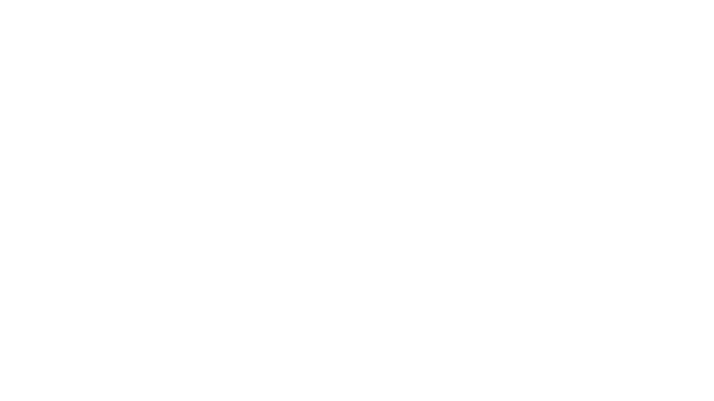
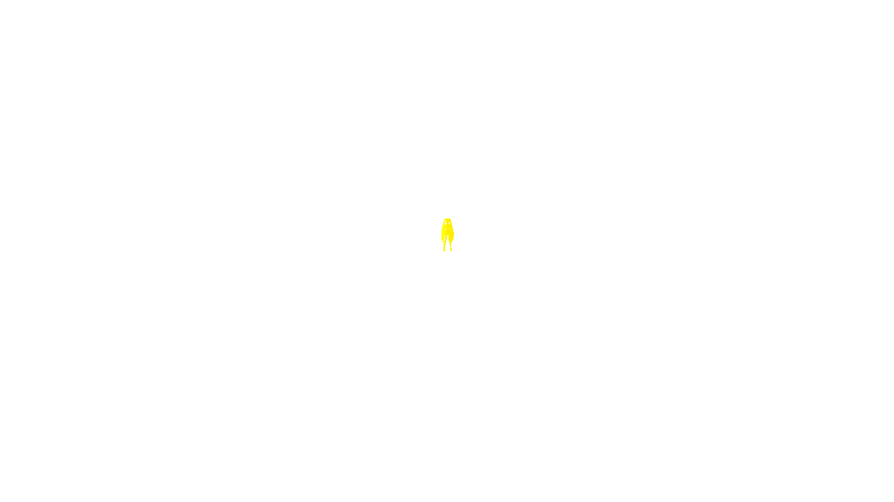

# 原始资源 MOD 原生导入候选 / Native resource MOD import candidate

2026-11-01。**这是 build20 发布之后的本地源码候选，不是已发布安装包的功能声明。**

## 本轮新下载的样本

从 GameBanana 选择此前未适配的两个包，而非继续复用 Leo/need 白名单：

| 包 | 作者页面 | 本轮源 ZIP MD5 | 内容 |
| --- | --- | --- | --- |
| Kimagure Mercy Miku Module 1.1 | [422082](https://gamebanana.com/mods/422082) | `7b4c0fd03b0b14c51c11c0e287b499bd` | Miku 服装和独立发饰 |
| Tonny’s Song Pack 1.2 | [427560](https://gamebanana.com/mods/427560) | `71187fac479162234c2d056518f129d2` | PV871《くたばろうぜ》、PV873《ビターチョコデコレーション》；视频 PV 与 FT 谱面 |

已核对网站提供的 MD5、ZIP CRC 和文件结构。源 ZIP、游戏资源、模型、歌曲及视频只保存在本地私有测试目录；本报告不包含这些资源。下载使用网站原始地址，再放入 App 的下载目录测试导入，**本轮没有验证应用内浏览器下载这两个样本的流程**。

## 已修改的实现

- 模型识别由单个包的哈希白名单扩展到受支持的资源结构；保留 Leo/need 精确配置。自动处理模型、纹理、服装、配饰、绑定关系和头像编号，合并原版数据库及多语言名称。
- 修复 Windows CRLF 属性文件解析。样本发饰自带头像 FARC，却没有对应的精灵数据库登记；只对已知的单头像结构补全登记，不猜测任意二进制字段。
- 新增常规视频歌曲转换：检查曲目与谱面、保留原始谱面字节、生成曲目列表、转换封面和列表缩略图、保留原版图集内容，处理资源路径别名。缩略图优先取作者的歌曲封面，遵守 SPR 与纹理相反的纵向原点，并复用原版缩略图的透明斜切布局；新图颜色全部来自新封面。像素区域、UV、组合后的贴图名称与登记表保持一致。
- 仅对已验证的普通 FT 视频谱面指令子集设置原生读取格式；拒绝未知指令、截断数据、时间倒退、额外场景依赖及未实现的玩法目标，不把 New Classics 当成普通 FT 谱面。
- USM/IVF VP9 逐帧转为 H.264 MP4。优先使用 VideoToolbox；系统缺少 VP9 解码器时使用内置 libvpx。视频与音频保持分离，不执行 Windows DLL、外部转换程序或 PC 插件。
- 组合时合并新缩略图，将扩展后的共享登记表带入后加载的 DLC，防止它覆盖回原版列表。DLC 没有独立图集时只接受与本包主登记表完全相同的别名，覆盖“转换后再次组合”的流程。保留完整校验、临时目录发布、取消和失败回滚机制。
- 统一资源目录的实际路径，修复链接目录下歌曲转换失败。增加明确指定的 Mac 隔离测试目录及独立 MOD 选择，测试会话不改正常配置。
- 修复首次新组合必须先保存设置才能开放新增歌曲难度的问题。游戏自己初始化歌曲记录后，在客体输入调用点限频重用已有开放策略；只改已初始化记录的开放标志，不创建歌曲 ID、成绩或通关记录，保存事务忙时跳过，不阻塞输入。

## 内存与转换测量

测试主机为 M3 Max / 64 GiB。下列为开发侧单独进程测量，**不代表 M1、iPhone 或真机 App 的峰值**：

| 测试 | 结果 |
| --- | --- |
| PV871 系统解码转码 | 6141 帧、204.700 秒、1920×1080 / 30 FPS；约 16.27 秒；峰值 RSS 约 45.3 MiB |
| PV871 强制备用解码转码 | 同样 6141 帧及 204.700 秒；约 16.30 秒；峰值 RSS 约 141.4 MiB |
| 封面最终修正前的整包转换候选 | 35 个运行文件；约 41.72 秒；峰值 RSS 约 259.2 MiB；不是最终 App 导入耗时测量 |

备用解码限制为 2 个线程，每个参考缓冲区不超过 32 MiB、参考缓冲区合计不超过 96 MiB，最多 6 个待编码 NV12 缓冲区；这些是组件边界，不是 App 总内存上限。文件复制与哈希按块进行，不将整段视频或 ZIP 载入内存。

## 验证边界

- 模型转换、CRLF、计数头 FARC 解码、组合顺序、冲突和取消回滚测试通过。
- 合成谱面测试覆盖完整电影谱面、未知指令、截断、时间倒退、玩法与场景依赖拒绝，以及结构识别、路径检查和取消；新增 RGBA／BC3 缩略图像素、裁切、纵向原点、外框透明度、原图颜色不混入新图及损坏贴图边界用例。
- 组合回归覆盖后加载 DLC 无本地图集、转换后再次组合、贴图名称一致及原图保留。开放策略用例验证游戏在挂载后新增记录时仍只修改开放标志，保留成绩字节。
- 最终 iOS 17 真机目标、模拟器目标及 Mac Catalyst 目标编译通过；编译不等于对应旧系统或物理设备已验收。
- Mac App 已从原始 ZIP 转换并勾选两包，组合由 App 自行生成。Kimagure 模型完成名称、预览、装备及《愛言葉》3D 演奏抽样。Tonny 包的《くたばろうぜ》EXTREME 完整结算：642 COOL／642 连击、697510 分、101.07%，全部为 AutoPlay 临时档。
- 最终歌曲转换配置为 `resource-video-song-5`，输出 35 个运行文件；组合器为 `native-composition-7`。独立读取核对 JP／CN／TW 的 258 张原缩略图及原纹理均保留，每套只新增 2 张。最终候选再次从原始 ZIP 转换、与模型包组合并完成整曲，结算同为 642 COOL／642 连击、697510 分、101.07%；大小封面、标题、视频方向与谱面显示已回看。新组合首次进入即显示新增 EXTREME，无需先保存设置。
- 最终整曲后核对 4 个事前记录的普通存档文件均未变化；所有隔离测试组合的 8 个普通存档文件仍与初始种子一致。结算只写入 AutoPlay 临时目录，画面中的 NEW RECORD 不代表普通档产生了真实成绩。
- 重启 App 后两包选择仍保留；在管理器选择“停用 MOD（原版游戏）”并加载，原版片头、标题和主菜单恢复正常。本项验证为重启后的配置切换，不作为同进程游戏会话热重启的证明。
- AutoPlay 会话使用独立临时存档，不作为真人判定、音画同步、真实成绩保存或长期稳定性的证明。

当前不是“任意 GameBanana MOD 通吃”。开放的是受支持的资源型模型和常规视频歌曲路径；复杂 3D 舞台、Auth3D／动作转换、New Classics、代码插件及未知包结构仍需适配。7z／RAR 仍需先解压后导入文件夹。曲目编号目前限制为 1–999，遇到原版或其他包的语义冲突会拒绝，不静默覆盖成绩或资源。

## 游戏内画面

以下是最终 Mac 候选从游戏场景输出捕获的画面，位于 MetalFX／HDR 和宿主 HUD 之前；不作为这些增强功能的画质证明。游玩和结算均为不记录真实成绩的 AutoPlay 测试。

## English

This is a **local source candidate after the build20 release**, not a claim about the public installer. Two previously unadapted GameBanana samples were downloaded: Kimagure Mercy Miku Module 1.1 and Tonny’s Song Pack 1.2, linked and identified above. Author-provided MD5 and ZIP CRC checks passed. Payloads remain private. The downloads were staged into the App’s Downloads folder; the in-app browser download flow was not tested with these samples.

The candidate adds structural resource-model discovery without an author/hash allowlist, accessory and portrait mapping, CRLF parsing, and native conversion of conventional movie-only FT song packs. It preserves chart bytes, builds native song/cover/thumbnail registries, converts streamed USM/VP9 to H.264 MP4, and merges selected packages transactionally. Small jackets use the author's jacket art when present, respect the opposite SPR/texture vertical origins and retain the native slanted transparency layout without copying its artwork colors. Texture labels match their registry entries. Later DLC registries inherit the expanded shared thumbnail lookup without requiring a local atlas; exact package-local aliases survive a second composition pass. Resource aliases are resolved consistently. Mac trials have explicit isolated data and MOD-selection storage.

New-song availability previously required an unrelated settings save after the native game initialized its additional records. The existing unlock policy now also runs at a bounded guest input call site, changing availability flags of initialized records only. It synthesizes neither IDs nor scores/clears and skips busy save transactions without blocking input.

Only a validated common FT movie-chart command subset receives native script metadata. Unknown commands, truncated charts, backward timestamps, extra scene dependencies and unsupported gameplay targets are rejected. No Windows DLL or external conversion executable is run. VideoToolbox is preferred; a bounded, decoder-only libvpx fallback handles systems without a VP9 decoder. Original licenses and patent notices are retained in [ThirdParty](../ThirdParty/README.md).

On the M3 Max / 64 GiB development host, PV871 retained all 6141 frames and its 204.700-second duration at 1080p/30. The forced software-decoder process peaked at about 141.4 MiB RSS. A whole-pack candidate before the final cover fixes produced 35 runtime files in about 41.72 seconds with about 259.2 MiB peak RSS. This is not the final App's import-time measurement. These are standalone development-process measurements, **not physical-device App memory or M1 performance claims**.

Model/format/composition tests and synthetic chart/thumbnail-boundary tests passed, including later-DLC shared lookups, converted-package recomposition and original-image preservation. Availability tests preserve score bytes when the native game registers a new song after mount. Final Mac Catalyst, Simulator and iOS 17 device-target builds passed; this does not qualify physical hardware or older operating systems.

Both raw ZIPs were converted and combined by the Mac App. Kimagure's name, portrait, equipment and Ai Kotoba 3D gameplay were sampled. The final song profile is `resource-video-song-5` with 35 runtime files; composition revision is `native-composition-7`. After another raw-ZIP conversion and model/song composition, Let's Drop Dead EXTREME again completed with 642 COOL / 642 combo, 697510 points and 101.07% in a disposable AutoPlay session. Small/large jackets, titles, upright video and chart presentation were visually inspected. The new EXTREME chart appeared on the fresh combination's first entry without an unrelated settings save. Independent readback confirmed that all 258 original thumbnails and texture payloads remain intact for JP/CN/TW, with only two new sprites per atlas.

All four ordinary-save files recorded before the final trial remained unchanged; all eight ordinary-save files across the isolated test profiles still matched their initial seed. The result screen's NEW RECORD belongs to the temporary AutoPlay session. It does not create a normal score. AutoPlay does not prove human input, synchronization or normal score persistence. Screenshots above capture game scene output before MetalFX/HDR and the host HUD; they do not validate those enhancement stages.

Both selections persisted after restarting the App. Selecting Disable MODs (original game) and loading restored the original opening, title and main menu. This checks configuration switching after an App restart, not a same-process guest-session hot restart.

This is not universal PC MOD compatibility. Complex 3D stages, Auth3D/motion conversion, New Classics, code plugins and unknown layouts still need adapters. Extract 7z/RAR before folder import. Song IDs currently remain within 1–999; semantic conflicts are rejected rather than overwriting unrelated content or scores.

Format references: [MikuMikuLibrary](https://github.com/blueskythlikesclouds/MikuMikuLibrary), [ReDIVA DSC layouts](https://github.com/korenkonder/ReDIVA/blob/master/src/KKdLib/dsc.cpp), [libvpx 1.17.0](https://github.com/webmproject/libvpx/tree/v1.17.0). The separate Switch loader remains a research reference: [MikuMikuSwitchPlugin](https://github.com/lsmsmx/MikuMikuSwitchPlugin).
