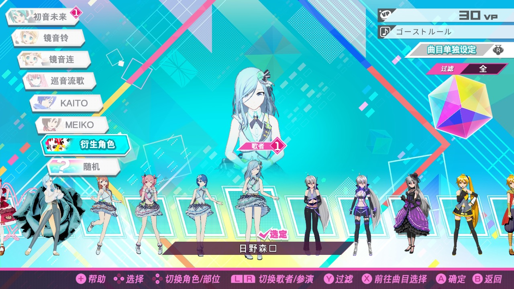

# PJDV M39 0.2.0 build 6

2026-11-25 · [English](#english)

## 15 包组合在 Mac 上的实测

在配备 M3 Max 的 Mac 上，MEGA39’s 日版 1.0.9 同时加载了 13 个模型包和 2 个曲包。17 个可用安装项中，Leo/need 和 Racing Miku 2026 各有两个版本。本次各启用新版，旧版作为可切换的版本保留。

| 检查 | 结果 |
| --- | --- |
| 衣柜 | 合并后核对到全部 49 套新增服装。原有空位用完后，17 套服装分配到了额外核验过的编号。六张语言表中原版已登记服装和饰品的名称均保留。 |
| 选曲 | 基础歌单的 221 条记录全部保留，已适配的 X Song Pack 1.21 加入 32 条，Tonny 加入 2 条，共 255 条。五份封面索引各有 303 个成员。日文、简中、繁中图集中的封面像素和索引均已比对。 |
| 实际装备与重启 | 在《ゴーストルール》衣柜选中日野森雫（编号 949），游戏显示了她的头像和 3D 模型。三份模型资源的六段游戏读取数据与合并输出一致。正常重启后，选曲页仍显示已装备的日野森雫，15 包仍启用。组合使用单独存档，原版存档在测试前后的校验值相同。 |

**已知问题与验证范围。** 简体中文启用 Google Sans 后，日野森雫名字中的「雫」显示为方框。34 首歌均已核对入库，本轮未逐首播放。Steam 原始 X Song Pack 2.0 依赖 Windows 插件，本轮验证使用已适配的 1.21。整套 15 包在 iPhone／iPad 真机上的游玩仍待验证。

### 下载与显示

- 在资源主页打开「MOD 管理 → GameBanana」。作者页面的 **Manual Download → Download** 和 **Diva Mod Manager · 1-Click Install** 均可触发应用内下载。支持的包会尝试安装；勾选就绪的包后点「加载」。在「MOD 文件」中可以重新安装、导出或删除下载原档。
- Racing Miku 2024 的两种网页下载方式在 Mac 上取得了相同的 ZIP。安装后在文件库删除原档，模型的 47 个运行文件仍通过完整校验。iPhone 18 Pro 模拟器用同一份 ZIP 验证了安装、重复安装、取消删除和确认删除。
- Mac 的默认窗口内容区为 1920×1080 物理像素，2× Retina 显示器上为 960×540 点。桌面空间不足时按比例缩小。普通放大、MetalFX 和桌面匹配都遵守当前显示器的物理像素上限。

## English

On an M3 Max Mac running the Japanese MEGA39’s 1.0.9 data set, 13 model packs and 2 song packs were enabled together. The library contained 17 installable items, including two versions each of Leo/need and Racing Miku 2026. The newer versions were enabled for this test.

| Check | Result |
| --- | --- |
| Wardrobe | All 49 added costumes were present in the merged data. After the original free slots filled up, 17 costumes used additional IDs checked against the game data. The original registered costume and accessory labels were preserved in all six string tables. |
| Song select | The merged playlist retained all 221 original entries. The adapted X Song Pack 1.21 added 32 songs and Tonny’s pack added 2, for a total of 255. All five cover indexes contained 303 members. Cover pixels and indexes were checked in the Japanese, Simplified Chinese and Traditional Chinese atlases. |
| Equip and restart | Hinomori Shizuku (ID 949) appeared in the “Ghost Rule” wardrobe with her portrait and 3D model. Six segments read by the game across three model files matched the merged output. After a normal restart, Shizuku was still equipped at song select and all 15 packs were enabled. The original save checksums matched before and after using the combination’s separate save. [Wardrobe screenshot](images/release-0.2.0b6/shizuku-equipped.jpg) |

**Known issue and coverage.** With the Simplified Chinese UI and Google Sans enabled, the final character of 日野森雫 appears as a square. The database check covered all 34 added songs. Individual playback of all 34 and gameplay with this combination on physical iPhones and iPads remain unverified. The original Steam X Song Pack 2.0 requires a Windows plug-in. This test used the adapted 1.21 pack.

### Downloads and display

- Open **MOD Manager → GameBanana** in the launcher. An author’s **Manual Download → Download** or **Diva Mod Manager · 1-Click Install** link starts an in-app download. The app attempts to install supported archives. Select ready packages, then choose **Load**. Open **Mod Files** to reinstall, export or delete a downloaded archive.
- On Mac, both website download routes returned the same Racing Miku 2024 ZIP. After the archive was deleted, all 47 installed model files still passed verification. The iPhone 18 Pro simulator tested installation, repeat installation, cancelling deletion and confirming deletion with the same ZIP.
- The Mac window defaults to a 1920×1080 **physical-pixel** content area (960×540 points on a 2× Retina display). It scales down proportionally when desktop space is limited. Standard scaling, MetalFX and desktop matching all respect the current display’s physical pixel dimensions.
