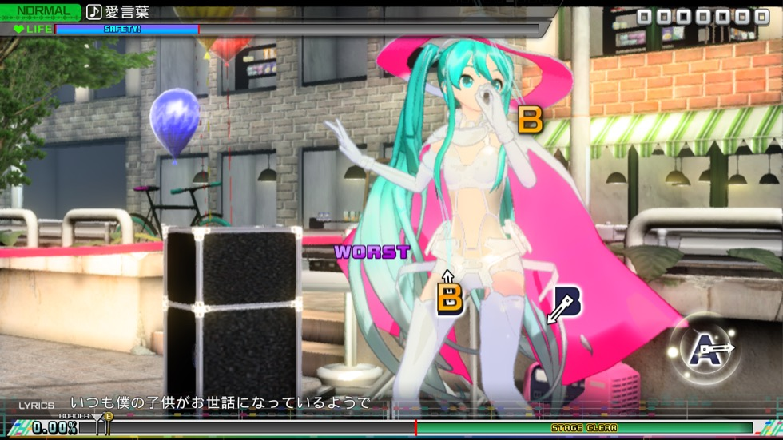

# PJDV M39 0.2.1 · build 7

2026-11-25 · [English](#english)

在「MOD 管理 → MOD 文件」安装下载包时，窗口会显示当前阶段、文件名和写入的相对目录。已知传输量时还会显示进度。安装结束后可查看日志，再点「返回」回到下载列表。需要 Windows 插件的包会显示具体的 DLL 名称。

## 验证记录

| 环境 | 操作 | 实际结果 |
| --- | --- | --- |
| M3 Max MacBook Pro，macOS 27.3 | 在独立资料库中安装作者的 Racing Miku 2024 ZIP | 日志显示真实的 `.farc` 文件及写入目录，转换完成后显示就绪位置。点「返回」回到下载列表。 |
| 同一台 Mac | 从衣柜装备 Racing Miku 2024，进入《愛言葉》NORMAL | 舞台上可见白帽和粉色披风。游戏从 5 个归档实际读取的 10 个模型与纹理成员，按偏移、长度和哈希均与已装 Mod 匹配。游玩抽测到歌曲进行中。 |
| 同一台 Mac | 安装 `ThumbnailSplitter.zip` | 窗口提示依赖 `ThumbnailSplitter.dll`，点「返回」后两个原档仍在，Racing Miku 仍可加载。日常资料库的 17 个安装项、15 个启用项和原版存档校验值与测试前一致。 |
| iPhone 18 Pro 模拟器 | 在独立资料库分别安装上述两包，两轮重复验证 | 成功和失败日志均显示对应的文件与结果。两种情况都能返回原列表。iOS 真机构建已通过编译，iPhone 和 iPad 真机验证仍待完成。 |

[Mac 安装成功窗口](images/release-0.2.1/install-complete.png) · [Mac 插件错误窗口](images/release-0.2.1/windows-plugin.png)

本页截图来自发布前验证的 build 7。正式版沿用该构建号，版本号改为 0.2.1。[升级说明](../README.md#更新到-021)

## English

When you install a download from **MOD Manager → Mod Files**, the installer shows the current step, file names and relative destination folders. It shows transfer progress when the total size is available. You can read the log after the operation finishes and choose **Back** to return to your downloads. If a package requires a Windows plug-in, the error names the DLL.

| Environment | Test | Observed result |
| --- | --- | --- |
| M3 Max MacBook Pro, macOS 27.3 | Installed the author’s Racing Miku 2024 ZIP in a separate library | The log showed actual `.farc` names, extraction destinations and the final converted package location. **Back** returned to the downloads. |
| Same Mac | Equipped the costume and played “Ai Kotoba” (NORMAL) | Miku wore the white hat and pink cape on stage. Offsets, byte counts and hashes for all ten model and texture members read from five archives matched the installed mod. The sample covered active gameplay. |
| Same Mac | Attempted to install `ThumbnailSplitter.zip` | The error named `ThumbnailSplitter.dll`. Both source downloads remained in the list after choosing **Back**, and Racing Miku was still available. The regular library retained its 17 installed items, 15 enabled items and original save checksums. |
| iPhone 18 Pro simulator | Repeated both installs twice in separate test libraries | The panel reported success for the costume and named the missing Windows dependency for the plug-in. Both paths returned to the download list. The iOS device build compiled. Testing on physical iPhones and iPads is still pending. |

[Mac install window](images/release-0.2.1/install-complete.png) · [Mac error window](images/release-0.2.1/windows-plugin.png) · [Racing Miku on stage](images/release-0.2.1/racing-miku-2024-ai-kotoba.jpg)

The screenshots come from the build 7 release candidate. The release retains build number 7 and carries version 0.2.1. [Upgrade instructions](../README.en.md#updating-to-021)
