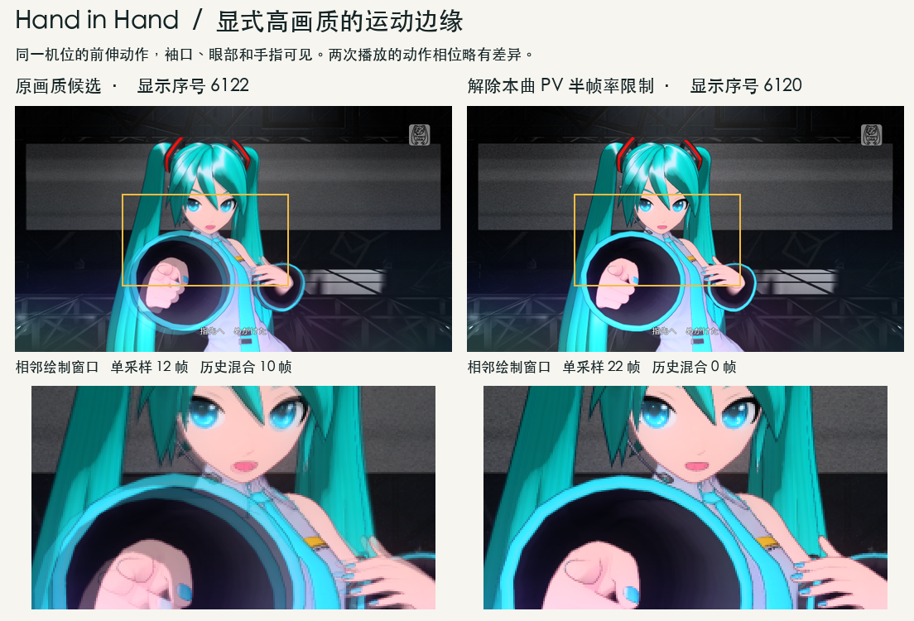
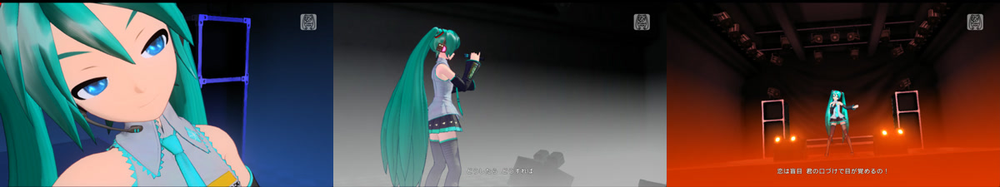

# build26 · MV 画质与载入 / MV quality and loading

2026-11-25 · PJDV M39 0.1.5 build26

## 玩家会看到什么

《39みゅーじっく！》《Hand in Hand》《テオ》在抽测开场镜头的人物源分辨率从 880×495 提高到 1280×720。这个变化发生在最终放大之前，对普通放大和 MetalFX 都有用。启动页的「自动」在 Apple GPU family 9 及以上启用，较早的硬件可以手动选择「高画质」。标准档保留游戏原始配置。游戏仅对匹配的日版 v1.0.9 资源应用调整，Mod 自己提供的对应歌曲参数优先。

《Hand in Hand》和《テオ》在显式选择「高画质」后还会解除歌曲开头的掌机 PV 30 FPS 限制。在同一机位附近，两首歌各抽查两组连续 8 帧。之前分别有 7 帧和 8 帧把上一帧混入当前画面。新高画质档的样本中每一帧都重新绘制了角色，手指和袖口的双重轮廓减轻。「自动」保留原作的 PV 更新节奏。

## 实测范围

M3 Max 上运行 11 英寸 M5 iPad Pro 模拟器，选用 1080p 输出、原生 60 FPS、默认服装和原始资源。高画质对照在同步截图结束后至少再间隔 120 个源帧，使用两次运行都覆盖的游戏段落。Mac 的 MetalFX 测试使用两首歌的实播源帧，在 M3 Max 上分别生成 1080p 和 1440p 图像。

| 曲目 | 本轮结果 |
| --- | --- |
| Hand in Hand | 高档改动前后约 60.0 FPS。自确认选曲到舞台清楚可见，两版各测两次均约 16.4–17.2 秒。 |
| テオ | 高档对照片段约 60.0 → 55.7 FPS，P95 帧间隔约 18.2 → 21.4 ms。更密集的角色重绘有性能代价。 |
| 恋は戦争 | 158 秒音轨播放到自然结束，并出现重试／返回选曲菜单。人脸近景、灰雾和结尾红灯舞台均有画面。开场人物在自动和高画质下都以 960×540 绘制。 |
| ゴーストルール | EXTREME 实际谱面用隔离 AutoPlay 存档打歌。45 秒窗口平均显示 59.97 FPS，P95 为 19.08 ms，最长一帧 26.99 ms。原有普通存档经核对保持一致。 |

多层目录现在复用父目录查找结果。M3 Max 对 2,050 个真实资源目录项的暖态枚举中位数由 91.96 ms 降至 53.37 ms。《Hand in Hand》载入时仍连续用 569 个显示帧逐张初始化并登记 569 张舞台纹理，在 60 Hz 下约占 9.5 秒。整曲入口的提速仍有待优化。以上帧率属于模拟器抽测，真机持续性能、温升和真人输入延迟仍待测量。

## What changes for players

The opening shots sampled in “39 Music!”, “Hand in Hand” and “Teo” draw characters at 1280×720 compared with the previous 880×495. This applies before ordinary scaling or MetalFX. Automatic enables it on Apple GPU family 9 and later. Earlier hardware can opt in through High Quality. Standard uses the original settings. The adjustments require matching stock Japanese v1.0.9 assets and respect song parameters supplied by Mods.

Choosing High Quality also lifts the original handheld PV frame cap at the start of “Hand in Hand” and “Teo”. We sampled two sequences of eight consecutive frames per song. Previously, seven frames in “Hand in Hand” and eight in “Teo” blended in a previous frame. With the new setting, every sampled frame redrew the character. The comparison above shows the change around the hand and sleeve. Automatic preserves the original PV update cadence.

## Test results

Tests ran on an 11-inch M5 iPad Pro simulator hosted on an M3 Max, with 1080p output, native 60 FPS, default costumes and stock assets. We compared frame times in overlapping sections at least 120 source frames after synchronous screenshot capture. Separate Mac GPU tests used captured gameplay frames from two songs to exercise MetalFX Spatial at 1080p and 1440p.

| Song | Observation |
| --- | --- |
| Hand in Hand | Both High Quality builds displayed about 60.0 FPS. Two loading runs per build took about 16.4–17.2 seconds from song confirmation to a clearly visible stage. |
| Teo | The High Quality comparison went from about 60.0 to 55.7 FPS. The 95th-percentile frame interval rose from 18.2 to 21.4 ms as more frames redrew the character. |
| Love Is War | The 158-second track played through to the retry/song selector menu. The face close-up, gray fog and red-lit finale were visible. Both Automatic and High Quality drew the character at 960×540 in the opening shot. |
| Ghost Rule | An isolated AutoPlay save ran the EXTREME chart. The 45-second window averaged 59.97 displayed FPS, with a 19.08 ms 95th-percentile interval and a 26.99 ms maximum. The ordinary save matched the original after testing. |

Layered resource directories now reuse parent lookups. Warm enumeration of 2,050 entries on the M3 Max fell from a median of 91.96 ms to 53.37 ms. During loading, “Hand in Hand” still initializes and registers its 569 stage textures over 569 consecutive display frames, about 9.5 seconds at 60 Hz. End-to-end song loading remains an area for improvement. Sustained physical-device FPS, thermals and human input latency remain unmeasured in this round.
