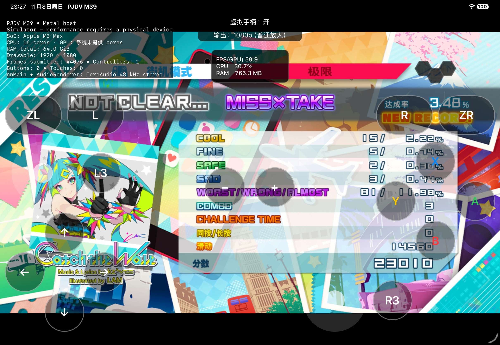

# Touch Play 点击有动画但不判定 / Animated touches without judgments

2026-11-08 · build22 修复与验证记录 / build22 fix and validation record

对应 [GitHub issue #1](https://github.com/HachiMiku39/pjdv_mega39s_ios/issues/1)。玩家报告原生 Touch Play 点按会播放动画，但节奏判定和 SLIDE 均不生效。

## 定位与修改

玩家日志中，菜单的 FullKey 输入对象能连接并收到按键；打歌时切换到另一输入对象后，连接状态为 0。原日志没有开启逐触点诊断，不能据此认定前端没有收到触摸。

对本机已适配的 v1.0.9 程序检查发现：原生 Touch Play 使用 Handheld 输入对象，其连接状态与触屏动画分别处理。游戏登记外接玩家 ID 0–3，却在 Touch Play 中查询集成 Handheld ID 0x20；旧兼容层既要求显式登记该 ID，也按主机画质配置将它断开。另一个门限是运行模式：[SEGA 官方说明](https://miku.sega.jp/mega39s/etc/)明确指出 Touch Play 不用于 TV 模式。

本地候选只在 `DM_GAME_M39` 下修改：

- 为非空且有效的玩家 ID 集合保留集成 Handheld；空 ID 集合继续关闭全部输入，游戏排除 Handheld 样式时继续尊重样式限制。
- 保留玩家 0 的 FullKey 外接／虚拟手柄路径，不用 Handheld 取代它；集成控制器连接状态不再被主机画质档断开。
- 运行模式向 M39 报告可触屏的 Handheld；性能模式仍读取独立的高／低配置，其他游戏保留原有运行模式语义。

未修改谱面、判定窗口或计分代码。已有的触点队列、快速重按、取消及顺序发布实现保持不变。

## 验证结果与边界

| 检查 | 结果 |
| --- | --- |
| 实际 C Npad 服务，ASan／UBSan | 通过：ID、样式、Handheld 双侧连接、FullKey、短按与释放、空 ID 隔离 |
| 实际 C 触屏队列，ASan／UBSan | 通过：四触点边界、快速重按、取消、队列溢出与恢复 |
| Swift 输入合并／顺序发布 | 通过：来源隔离、并发、旧快照拒绝、取消代次 |
| M39 运行模式／性能档 | 通过：触屏运行模式与高低性能档独立、会话复位 |
| 非 M39 运行模式 | 通过：旧运行模式、性能及临时 UI override 保留 |
| Release 编译 | iOS 与 iOS Simulator 通过 |
| 原生点按实测 | 《愛言葉》NORMAL，实际触屏产生 250 分 |
| 原生滑动实测 | 《Catch the Wave》EXTREME，15 COOL／5 FINE，SLIDE 14560 分，总分 23010 |

实测使用 M5 iPad 模拟器配置（iPadOS 27.2，实际宿主 M3 Max），原版资源、无 Mod、1080p 普通输出、高配置值 1。AutoPlay 关闭；打歌测试时隐藏宿主虚拟手柄，只向游戏画布发送原生触摸。Catch the Wave 从开头连续左右拖动，包含拖动起落产生的点按；结算中的独立 SLIDE 得分证明滑动进入了原版判定流程。宿主虚拟手柄仅用于菜单导航与结算后检查。

这是输入路径验证，并非整曲通关或真人音画时序验收。测试失败退出是未演奏其余音符所致。所有分数写入独立测试目录，源存档哈希保持不变，未上传排行榜。

仍需实际 iPad／iPhone 验证多押、长按、连续滑键、手柄热插拔和长时间游玩。高性能配置及 1080p 输出均保留，但修改运行模式后原版内部画质是否完全等同仍需独立画面对照；不以输出尺寸证明内部画质一致。未在本轮测试 macOS 触屏或发布新版 DMG。

## 玩家回测

使用修复候选覆盖安装，先备份存档。候选 IPA 不带签名，需自行使用有效签名安装，不含游戏资源、密钥、Mod 或存档。

1. 进入游戏 → 街机模式 → 自定义 → 游戏与操作设定 → 街机模式 → Touch Play 开启。
2. 关闭宿主顶部“虚拟手柄”，避免覆盖层拦截原生触屏区域。此步骤与游戏内 Touch Play 开关不同。
3. 关闭 AutoPlay，检查四个屏幕分区的点按／长按和任意位置的左右 flick／长滑键，观察实际判定和分数。
4. 回报安装文件名、设备、画质配置与新的运行日志；请同时描述动画、判定文字及实际得分是否出现。

普通手柄游玩需要按原作设置关闭 Touch Play。官方说明同时指出 Touch Play 不提供震动，不能用该模式验证 DS5 震动。

---

## English

[Issue #1](https://github.com/HachiMiku39/pjdv_mega39s_ios/issues/1) reports animated native Touch Play buttons without rhythm or SLIDE judgments. The player's log shows a connected FullKey menu input object and a disconnected gameplay input object. It does not contain per-touch diagnostics, so it cannot establish that frontend touches were missing.

Inspection of the locally adapted v1.0.9 executable identifies a separate Handheld gameplay input object. The game registers external player IDs 0–3 but Touch Play queries integrated ID 0x20. The previous bridge filtered this device both by registration and by the console graphics profile. Operation mode is another constraint: [SEGA's official Touch Play instructions](https://miku.sega.jp/mega39s/etc/) exclude TV mode.

The M39-only fix retains the integrated Handheld alongside valid registered players, keeps FullKey routing for player 0, honors empty IDs and style exclusions, and reports touch-capable operation independently from the selected performance profile. Other games retain their existing operation-mode behavior. Chart data, scoring and judgment windows are unchanged.

The actual C Npad/touch implementations pass AddressSanitizer and UndefinedBehaviorSanitizer checks; Swift source merging and ordered publication, both operation-mode variants and Release iOS/Simulator builds pass. Native touches produced 250 points in Ai Kotoba NORMAL. A second test using native drags from the start of Catch the Wave EXTREME produced **15 COOL, 5 FINE, 14560 SLIDE points and 23010 total points**. Drag starts can also produce taps; the separate SLIDE result is the relevant swipe evidence.

The M5 iPad simulator configuration runs on an M3 Max host, iPadOS27.2, original resources, no Mod, 1080p ordinary output and high-profile setting1. AutoPlay was off; the host virtual pad was hidden during gameplay. These were partial input-path tests, not full clears, human timing acceptance or device-performance measurements. Isolated test saves were used, original save hashes were unchanged, and no scores were uploaded. Physical-device multitouch/hold/chain-slide/controller-reconnection acceptance remains pending. High performance mode and output resolution remain selected, but internal graphics equivalence after the operation-mode change requires a separate comparison. No Mac touch test or new DMG was produced here.

For retesting: update in place after backing up saves; enable native Touch Play in the game's Arcade operation settings; hide the host virtual pad; disable AutoPlay; test tap/hold/flick/chain inputs and inspect judgments and scores. The unsigned lightweight candidate requires your own valid signing and excludes game payloads, keys, Mods and saves. Native Touch Play intentionally disables controller rhythm input and vibration under the original game's rules; disable it before normal controller testing.
